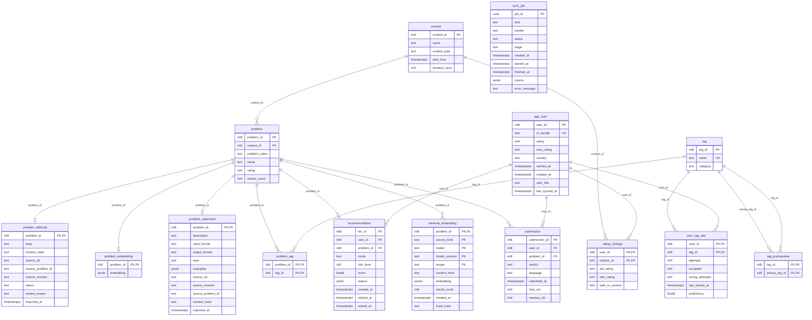
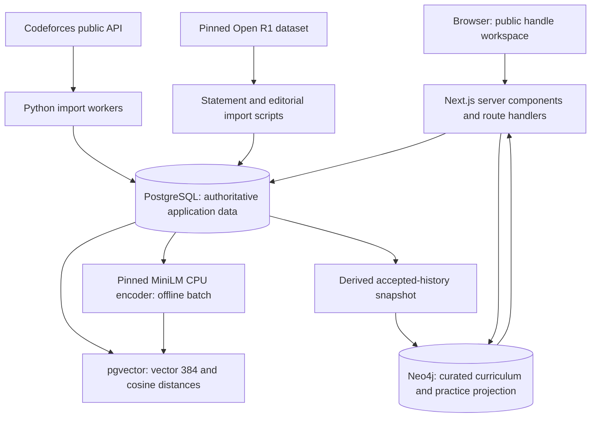
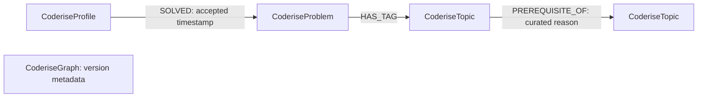
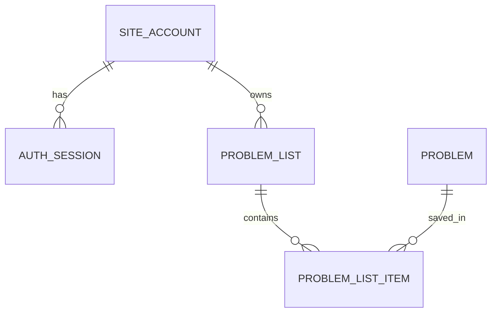

# Coderise — Database Design

> Schema update: the original 15-table reference below is extended by five account/list tables in the migration 008 addendum at the end. Account and administrator-token descriptions in the original snapshot are superseded by [the current account guide](docs/ACCOUNTS_LISTS.md). The current physical schema has 20 tables.


Implementation-aligned reference for the Coderise course project. PostgreSQL is the system of record, pgvector stores semantic retrieval vectors, and Neo4j stores the derived topic prerequisite and learning-map graph. This document describes the current implementation, including reserved legacy structures where called out.

---

## ER diagram

# Physical ER diagram

Includes reserved/legacy tables; see the data dictionary for active versus legacy use. Each child FK requires one parent; parents can have zero children. One-to-one extensions use a foreign key that is also the complete primary key.



---

## Architecture and data flow

# System architecture and data ownership



## Relational model

Contest contains problems; each problem has a canonical contest/index alternate key. Problem/tag membership is many-to-many through `problem_tag`. Submission records connect a profile to a problem, and rating changes connect profiles to contests. `user_tag_stat` materializes per-profile/per-tag aggregates. Statement and editorial tables are optional one-to-one problem extensions. A problem can have multiple retrieval embeddings distinguished by source kind, model, revision and recipe.

## Vector model

`retrieval_embedding.embedding` is native `vector(384)`, not JSONB or a floating-point array. Cached inputs are editorial explanations or statement description/input/output text. The model and recipe are pinned in `config/retrieval.json`. Provenance includes source/content hash, prepared-input hash, model identity and chunk count. Constraints reject invalid dimensions, non-finite values, zero vectors and non-unit norms within the implemented tolerance.

The freshness view excludes changed sources and held-out editorials. Recommendations use SQL rating/solved constraints to shortlist candidates, then exact pgvector cosine distances against recent compatible history. Editorial evidence takes precedence over statement evidence. HNSW cosine indexes exist for catalogue similarity; bounded recommendation scoring deliberately remains exact. Scalar similarities reach the ranker; editorial bodies and vectors are not sent to the browser. Similarity and final ranking scores are not solve probabilities.

## Graph model



`CoderiseTopic`: unique key, graph namespace, ID, display name, Codeforces tag, summary, version. `CoderiseGraph`: unique key, version, projectionVersion, curated flag and update time. `CoderiseProfile`: unique key, graph namespace, public handle, snapshot hash, source timestamp and lock counter. `CoderiseProblem`: unique key, graph namespace, canonical contest/index key, name, rating and contest/index attributes. All four labels have indexed key uniqueness constraints.

Prerequisite edges are authored background recommendations, not Codeforces facts or universal learning requirements. SOLVED edges represent imported accepted evidence; HAS_TAG links to the mapped curriculum topics. These relationships do not prove which technique was used.

The loader seeds 19 topics and 21 background edges. On map requests, a single PostgreSQL history snapshot supplies authoritative counts and a hashed accepted-problem projection. A Neo4j transaction takes a per-profile lock, replaces changed managed SOLVED relationships and merges problem/topic links. A source timestamp guard prevents older overlapping profile snapshots from replacing newer ones. Recent examples are read through graph traversal and checked against SQL counts. Other profiles' SOLVED edges are not cleared.

## Problem preparation data flow

1. Parse a Codeforces link/ID without fetching arbitrary URLs.
2. Look up its metadata/tags in PostgreSQL.
3. Use all mapped tags as Neo4j goals, retrieving the union of their ancestors.
4. Choose a background review position from imported practice evidence.
5. Query easier rated problems by topic, excluding the target and imported accepted problems; distribute up to three distinct questions per topic.
6. Display map/list, statement previews and a retry link. Unmapped tags, unrated targets and minimum-rated targets have explicit fallback explanations.

## Service boundaries

PostgreSQL history is authoritative; Neo4j practice data can be rebuilt. Curriculum JSON is authoritative for graph prerequisites. The browser cannot directly query either database. Credentials are local runtime configuration, excluded from Git. Public readers need no learner account; developer catalogue operations use separate protected access. Local `.env` configuration is not an encrypted secret vault.

Neo4j outages produce an unavailable preparation/map response; other workspace pages remain independent. Cached PostgreSQL data remains usable when Codeforces cannot refresh. Statement/model imports are explicit scripts. Profile active-page refresh is not an unattended catalogue scheduler.

---

## Relational schema and indexes

# Relational schema and database objects

Catalogue-verified on 2 November 2026. Complete column-level details: [data dictionary](#data-dictionary). The executable schema-only export is [schema.sql](#schema-only-sql-export).

## app_user

`app_user(user_id, cf_handle, rating, max_rating, country, verified_at, created_at, rank_title, last_synced_at)`

- `UNIQUE (cf_handle)`
- `PRIMARY KEY (user_id)`

## contest

`contest(contest_id, name, contest_type, start_time, duration_secs)`

- `PRIMARY KEY (contest_id)`

## problem

`problem(problem_id, contest_id, problem_index, name, rating, solved_count)`

- `FOREIGN KEY (contest_id) REFERENCES contest(contest_id) ON DELETE RESTRICT`
- `UNIQUE (contest_id, problem_index)`
- `PRIMARY KEY (problem_id)`

## problem_editorial

`problem_editorial(problem_id, body, content_hash, source_url, source_problem_id, source_revision, status, review_reason, imported_at)`

- `PRIMARY KEY (problem_id)`
- `FOREIGN KEY (problem_id) REFERENCES problem(problem_id) ON DELETE CASCADE`

## problem_embedding

`problem_embedding(problem_id, embedding)`

- `PRIMARY KEY (problem_id)`
- `FOREIGN KEY (problem_id) REFERENCES problem(problem_id) ON DELETE CASCADE`

## problem_statement

`problem_statement(problem_id, description, input_format, output_format, note, examples, source_url, source_revision, source_problem_id, content_hash, imported_at)`

- `PRIMARY KEY (problem_id)`
- `FOREIGN KEY (problem_id) REFERENCES problem(problem_id) ON DELETE CASCADE`

## problem_tag

`problem_tag(problem_id, tag_id)`

- `PRIMARY KEY (problem_id, tag_id)`
- `FOREIGN KEY (problem_id) REFERENCES problem(problem_id) ON DELETE CASCADE`
- `FOREIGN KEY (tag_id) REFERENCES tag(tag_id) ON DELETE RESTRICT`

## rating_change

`rating_change(user_id, contest_id, old_rating, new_rating, rank_in_contest)`

- `FOREIGN KEY (contest_id) REFERENCES contest(contest_id) ON DELETE RESTRICT`
- `PRIMARY KEY (user_id, contest_id)`
- `FOREIGN KEY (user_id) REFERENCES app_user(user_id) ON DELETE CASCADE`

## recommendation

`recommendation(rec_id, user_id, problem_id, mode, hint_level, score, reason, created_at, clicked_at, solved_at)`

- `PRIMARY KEY (rec_id)`
- `FOREIGN KEY (problem_id) REFERENCES problem(problem_id) ON DELETE RESTRICT`
- `FOREIGN KEY (user_id) REFERENCES app_user(user_id) ON DELETE CASCADE`

## retrieval_embedding

`retrieval_embedding(problem_id, source_kind, model, model_revision, recipe, content_hash, embedding, chunk_count, created_at, input_hash)`

- `PRIMARY KEY (problem_id, source_kind, model, model_revision, recipe)`
- `FOREIGN KEY (problem_id) REFERENCES problem(problem_id) ON DELETE CASCADE`

## submission

`submission(submission_id, user_id, problem_id, verdict, language, submitted_at, time_ms, memory_kb)`

- `PRIMARY KEY (submission_id)`
- `FOREIGN KEY (problem_id) REFERENCES problem(problem_id) ON DELETE RESTRICT`
- `FOREIGN KEY (user_id) REFERENCES app_user(user_id) ON DELETE CASCADE`

## sync_job

`sync_job(job_id, kind, handle, status, stage, created_at, started_at, finished_at, counts, error_message)`

- `PRIMARY KEY (job_id)`

## tag

`tag(tag_id, name, category)`

- `UNIQUE (name)`
- `PRIMARY KEY (tag_id)`

## tag_prerequisite

`tag_prerequisite(tag_id, prereq_tag_id)`

- `PRIMARY KEY (tag_id, prereq_tag_id)`
- `FOREIGN KEY (prereq_tag_id) REFERENCES tag(tag_id) ON DELETE CASCADE`
- `FOREIGN KEY (tag_id) REFERENCES tag(tag_id) ON DELETE CASCADE`

## user_tag_stat

`user_tag_stat(user_id, tag_id, attempts, accepted, wrong_attempts, last_solved_at, proficiency)`

- `PRIMARY KEY (user_id, tag_id)`
- `FOREIGN KEY (tag_id) REFERENCES tag(tag_id) ON DELETE RESTRICT`
- `FOREIGN KEY (user_id) REFERENCES app_user(user_id) ON DELETE CASCADE`

## Indexes

- `app_user_cf_handle_key`: `CREATE UNIQUE INDEX app_user_cf_handle_key ON public.app_user USING btree (cf_handle)`
- `app_user_handle_ci_idx`: `CREATE UNIQUE INDEX app_user_handle_ci_idx ON public.app_user USING btree (lower(cf_handle))`
- `app_user_pkey`: `CREATE UNIQUE INDEX app_user_pkey ON public.app_user USING btree (user_id)`
- `contest_pkey`: `CREATE UNIQUE INDEX contest_pkey ON public.contest USING btree (contest_id)`
- `problem_contest_id_problem_index_key`: `CREATE UNIQUE INDEX problem_contest_id_problem_index_key ON public.problem USING btree (contest_id, problem_index)`
- `problem_name_search_idx`: `CREATE INDEX problem_name_search_idx ON public.problem USING gin (to_tsvector('simple'::regconfig, name))`
- `problem_pkey`: `CREATE UNIQUE INDEX problem_pkey ON public.problem USING btree (problem_id)`
- `problem_rating_popularity_idx`: `CREATE INDEX problem_rating_popularity_idx ON public.problem USING btree (rating, solved_count DESC)`
- `problem_editorial_pkey`: `CREATE UNIQUE INDEX problem_editorial_pkey ON public.problem_editorial USING btree (problem_id)`
- `problem_embedding_pkey`: `CREATE UNIQUE INDEX problem_embedding_pkey ON public.problem_embedding USING btree (problem_id)`
- `problem_statement_pkey`: `CREATE UNIQUE INDEX problem_statement_pkey ON public.problem_statement USING btree (problem_id)`
- `problem_tag_pkey`: `CREATE UNIQUE INDEX problem_tag_pkey ON public.problem_tag USING btree (problem_id, tag_id)`
- `problem_tag_tag_problem_idx`: `CREATE INDEX problem_tag_tag_problem_idx ON public.problem_tag USING btree (tag_id, problem_id)`
- `rating_change_pkey`: `CREATE UNIQUE INDEX rating_change_pkey ON public.rating_change USING btree (user_id, contest_id)`
- `recommendation_pkey`: `CREATE UNIQUE INDEX recommendation_pkey ON public.recommendation USING btree (rec_id)`
- `retrieval_editorial_cosine_hnsw`: `CREATE INDEX retrieval_editorial_cosine_hnsw ON public.retrieval_embedding USING hnsw (embedding vector_cosine_ops) WHERE (source_kind = 'editorial'::text)`
- `retrieval_embedding_pkey`: `CREATE UNIQUE INDEX retrieval_embedding_pkey ON public.retrieval_embedding USING btree (problem_id, source_kind, model, model_revision, recipe)`
- `retrieval_statement_cosine_hnsw`: `CREATE INDEX retrieval_statement_cosine_hnsw ON public.retrieval_embedding USING hnsw (embedding vector_cosine_ops) WHERE (source_kind = 'statement'::text)`
- `submission_pkey`: `CREATE UNIQUE INDEX submission_pkey ON public.submission USING btree (submission_id)`
- `submission_solved_user_problem_idx`: `CREATE INDEX submission_solved_user_problem_idx ON public.submission USING btree (user_id, problem_id) WHERE (verdict = 'OK'::text)`
- `submission_user_time_idx`: `CREATE INDEX submission_user_time_idx ON public.submission USING btree (user_id, submitted_at DESC)`
- `sync_job_active_catalogue_idx`: `CREATE UNIQUE INDEX sync_job_active_catalogue_idx ON public.sync_job USING btree (kind) WHERE ((kind = 'catalogue'::text) AND (status = ANY (ARRAY['queued'::text, 'running'::text])))`
- `sync_job_active_profile_idx`: `CREATE UNIQUE INDEX sync_job_active_profile_idx ON public.sync_job USING btree (lower(handle)) WHERE ((kind = 'profile'::text) AND (status = ANY (ARRAY['queued'::text, 'running'::text])))`
- `sync_job_latest_idx`: `CREATE INDEX sync_job_latest_idx ON public.sync_job USING btree (created_at DESC)`
- `sync_job_pkey`: `CREATE UNIQUE INDEX sync_job_pkey ON public.sync_job USING btree (job_id)`
- `tag_name_key`: `CREATE UNIQUE INDEX tag_name_key ON public.tag USING btree (name)`
- `tag_pkey`: `CREATE UNIQUE INDEX tag_pkey ON public.tag USING btree (tag_id)`
- `tag_prerequisite_pkey`: `CREATE UNIQUE INDEX tag_prerequisite_pkey ON public.tag_prerequisite USING btree (tag_id, prereq_tag_id)`
- `user_tag_stat_pkey`: `CREATE UNIQUE INDEX user_tag_stat_pkey ON public.user_tag_stat USING btree (user_id, tag_id)`

## Views

### retrieval_coverage

```sql
 SELECT count(*) AS catalogue_problems,
    count(ps.problem_id) AS with_statements,
    count(pe.problem_id) AS with_editorials,
    count(pe.problem_id) FILTER (WHERE (pe.status = 'ready'::text)) AS ready_editorials,
    count(*) FILTER (WHERE ((ps.problem_id IS NULL) AND (pe.problem_id IS NULL))) AS without_text
   FROM ((problem p
     LEFT JOIN problem_statement ps USING (problem_id))
     LEFT JOIN problem_editorial pe USING (problem_id));
```

### retrieval_current_embedding

```sql
 SELECT e.problem_id,
    e.source_kind,
    e.model,
    e.model_revision,
    e.recipe,
    e.content_hash,
    e.embedding,
    e.chunk_count,
    e.created_at,
    e.input_hash
   FROM (retrieval_embedding e
     JOIN problem_editorial pe ON (((pe.problem_id = e.problem_id) AND (pe.content_hash = e.content_hash))))
  WHERE ((e.source_kind = 'editorial'::text) AND (pe.status = 'ready'::text))
UNION ALL
 SELECT e.problem_id,
    e.source_kind,
    e.model,
    e.model_revision,
    e.recipe,
    e.content_hash,
    e.embedding,
    e.chunk_count,
    e.created_at,
    e.input_hash
   FROM (retrieval_embedding e
     JOIN problem_statement ps ON (((ps.problem_id = e.problem_id) AND (ps.content_hash = e.content_hash))))
  WHERE (e.source_kind = 'statement'::text);
```

### statement_coverage

```sql
 SELECT count(*) AS catalogue_problems,
    count(ps.problem_id) AS with_statements,
    (count(*) - count(ps.problem_id)) AS without_statements
   FROM (problem p
     LEFT JOIN problem_statement ps USING (problem_id));
```

### user_practice_summary

```sql
 SELECT u.user_id,
    u.cf_handle,
    u.rating,
    u.max_rating,
    u.rank_title,
    u.country,
    u.last_synced_at,
    count(s.submission_id) AS submission_count,
    count(DISTINCT s.problem_id) FILTER (WHERE (s.verdict = 'OK'::text)) AS solved_count,
    count(DISTINCT s.problem_id) AS attempted_count,
    count(s.submission_id) FILTER (WHERE (s.verdict = 'OK'::text)) AS accepted_submissions,
    min(s.submitted_at) AS history_start,
    max(s.submitted_at) AS latest_submission,
    count(s.submission_id) FILTER (WHERE (s.verdict <> ALL (ARRAY['TESTING'::text, 'SUBMITTED'::text]))) AS judged_count
   FROM (app_user u
     LEFT JOIN submission s USING (user_id))
  GROUP BY u.user_id;
```

---

## Data dictionary

# Data dictionary

Generated from the running PostgreSQL catalogue on 2 November 2026. Includes physical legacy tables; their presence does not imply active product features. SQL NULL is distinct from zero/empty text. TIMESTAMPTZ records instants; presentation may use UTC.

## app_user

Imported public Codeforces profiles; not authenticated accounts.

| Column | SQL type | Nullable | Default / identity |
|---|---|---|---|
| user_id | bigint | NO | identity |
| cf_handle | text | NO | — |
| rating | integer | YES | — |
| max_rating | integer | YES | — |
| country | text | YES | — |
| verified_at | timestamp with time zone | YES | — |
| created_at | timestamp with time zone | NO | now() |
| rank_title | text | YES | — |
| last_synced_at | timestamp with time zone | YES | — |

Constraints:

- `app_user_cf_handle_key`: `UNIQUE (cf_handle)`
- `app_user_cf_handle_not_null`: `NOT NULL cf_handle`
- `app_user_created_at_not_null`: `NOT NULL created_at`
- `app_user_max_rating_check`: `CHECK (((max_rating IS NULL) OR (max_rating >= 0)))`
- `app_user_pkey`: `PRIMARY KEY (user_id)`
- `app_user_rating_check`: `CHECK (((rating IS NULL) OR (rating >= 0)))`
- `app_user_user_id_not_null`: `NOT NULL user_id`

## contest

Codeforces contest metadata.

| Column | SQL type | Nullable | Default / identity |
|---|---|---|---|
| contest_id | integer | NO | — |
| name | text | NO | — |
| contest_type | text | YES | — |
| start_time | timestamp with time zone | YES | — |
| duration_secs | integer | YES | — |

Constraints:

- `contest_contest_id_not_null`: `NOT NULL contest_id`
- `contest_duration_secs_check`: `CHECK (((duration_secs IS NULL) OR (duration_secs >= 0)))`
- `contest_name_not_null`: `NOT NULL name`
- `contest_pkey`: `PRIMARY KEY (contest_id)`

## problem

Canonical problem catalogue and published difficulty/popularity.

| Column | SQL type | Nullable | Default / identity |
|---|---|---|---|
| problem_id | bigint | NO | identity |
| contest_id | integer | NO | — |
| problem_index | text | NO | — |
| name | text | NO | — |
| rating | integer | YES | — |
| solved_count | integer | NO | 0 |

Constraints:

- `problem_contest_id_fkey`: `FOREIGN KEY (contest_id) REFERENCES contest(contest_id) ON DELETE RESTRICT`
- `problem_contest_id_not_null`: `NOT NULL contest_id`
- `problem_contest_id_problem_index_key`: `UNIQUE (contest_id, problem_index)`
- `problem_name_not_null`: `NOT NULL name`
- `problem_pkey`: `PRIMARY KEY (problem_id)`
- `problem_problem_id_not_null`: `NOT NULL problem_id`
- `problem_problem_index_not_null`: `NOT NULL problem_index`
- `problem_rating_check`: `CHECK (((rating IS NULL) OR ((rating >= 800) AND (rating <= 3500))))`
- `problem_solved_count_check`: `CHECK ((solved_count >= 0))`
- `problem_solved_count_not_null`: `NOT NULL solved_count`

## problem_editorial

Internal editorial retrieval source and quality status.

| Column | SQL type | Nullable | Default / identity |
|---|---|---|---|
| problem_id | bigint | NO | — |
| body | text | NO | — |
| content_hash | text | NO | — |
| source_url | text | NO | — |
| source_problem_id | text | NO | — |
| source_revision | text | NO | — |
| status | text | NO | — |
| review_reason | text | NO | ''::text |
| imported_at | timestamp with time zone | NO | now() |

Constraints:

- `problem_editorial_body_check`: `CHECK ((length(TRIM(BOTH FROM body)) > 0))`
- `problem_editorial_body_not_null`: `NOT NULL body`
- `problem_editorial_content_hash_check`: `CHECK ((content_hash ~ '^[0-9a-f]{64}$'::text))`
- `problem_editorial_content_hash_not_null`: `NOT NULL content_hash`
- `problem_editorial_imported_at_not_null`: `NOT NULL imported_at`
- `problem_editorial_pkey`: `PRIMARY KEY (problem_id)`
- `problem_editorial_problem_id_fkey`: `FOREIGN KEY (problem_id) REFERENCES problem(problem_id) ON DELETE CASCADE`
- `problem_editorial_problem_id_not_null`: `NOT NULL problem_id`
- `problem_editorial_review_reason_not_null`: `NOT NULL review_reason`
- `problem_editorial_source_problem_id_not_null`: `NOT NULL source_problem_id`
- `problem_editorial_source_revision_not_null`: `NOT NULL source_revision`
- `problem_editorial_source_url_not_null`: `NOT NULL source_url`
- `problem_editorial_status_check`: `CHECK ((status = ANY (ARRAY['ready'::text, 'needs_review'::text])))`
- `problem_editorial_status_not_null`: `NOT NULL status`

## problem_embedding

Legacy JSONB embedding table; active vectors use retrieval_embedding.

| Column | SQL type | Nullable | Default / identity |
|---|---|---|---|
| problem_id | bigint | NO | — |
| embedding | jsonb | NO | — |

Constraints:

- `problem_embedding_embedding_check`: `CHECK ((jsonb_typeof(embedding) = 'array'::text))`
- `problem_embedding_embedding_not_null`: `NOT NULL embedding`
- `problem_embedding_pkey`: `PRIMARY KEY (problem_id)`
- `problem_embedding_problem_id_fkey`: `FOREIGN KEY (problem_id) REFERENCES problem(problem_id) ON DELETE CASCADE`
- `problem_embedding_problem_id_not_null`: `NOT NULL problem_id`

## problem_statement

Attributed statement text and source provenance.

| Column | SQL type | Nullable | Default / identity |
|---|---|---|---|
| problem_id | bigint | NO | — |
| description | text | NO | — |
| input_format | text | NO | ''::text |
| output_format | text | NO | ''::text |
| note | text | NO | ''::text |
| examples | jsonb | NO | '[]'::jsonb |
| source_url | text | NO | — |
| source_revision | text | NO | — |
| source_problem_id | text | NO | — |
| content_hash | text | NO | — |
| imported_at | timestamp with time zone | NO | now() |

Constraints:

- `problem_statement_content_hash_not_null`: `NOT NULL content_hash`
- `problem_statement_description_check`: `CHECK ((length(TRIM(BOTH FROM description)) > 0))`
- `problem_statement_description_not_null`: `NOT NULL description`
- `problem_statement_examples_check`: `CHECK ((jsonb_typeof(examples) = 'array'::text))`
- `problem_statement_examples_not_null`: `NOT NULL examples`
- `problem_statement_imported_at_not_null`: `NOT NULL imported_at`
- `problem_statement_input_format_not_null`: `NOT NULL input_format`
- `problem_statement_note_not_null`: `NOT NULL note`
- `problem_statement_output_format_not_null`: `NOT NULL output_format`
- `problem_statement_pkey`: `PRIMARY KEY (problem_id)`
- `problem_statement_problem_id_fkey`: `FOREIGN KEY (problem_id) REFERENCES problem(problem_id) ON DELETE CASCADE`
- `problem_statement_problem_id_not_null`: `NOT NULL problem_id`
- `problem_statement_source_problem_id_not_null`: `NOT NULL source_problem_id`
- `problem_statement_source_revision_not_null`: `NOT NULL source_revision`
- `problem_statement_source_url_not_null`: `NOT NULL source_url`

## problem_tag

Many-to-many problem/topic membership.

| Column | SQL type | Nullable | Default / identity |
|---|---|---|---|
| problem_id | bigint | NO | — |
| tag_id | bigint | NO | — |

Constraints:

- `problem_tag_pkey`: `PRIMARY KEY (problem_id, tag_id)`
- `problem_tag_problem_id_fkey`: `FOREIGN KEY (problem_id) REFERENCES problem(problem_id) ON DELETE CASCADE`
- `problem_tag_problem_id_not_null`: `NOT NULL problem_id`
- `problem_tag_tag_id_fkey`: `FOREIGN KEY (tag_id) REFERENCES tag(tag_id) ON DELETE RESTRICT`
- `problem_tag_tag_id_not_null`: `NOT NULL tag_id`

## rating_change

Contest rating history per profile.

| Column | SQL type | Nullable | Default / identity |
|---|---|---|---|
| user_id | bigint | NO | — |
| contest_id | integer | NO | — |
| old_rating | integer | YES | — |
| new_rating | integer | YES | — |
| rank_in_contest | integer | YES | — |

Constraints:

- `rating_change_contest_id_fkey`: `FOREIGN KEY (contest_id) REFERENCES contest(contest_id) ON DELETE RESTRICT`
- `rating_change_contest_id_not_null`: `NOT NULL contest_id`
- `rating_change_pkey`: `PRIMARY KEY (user_id, contest_id)`
- `rating_change_rank_in_contest_check`: `CHECK (((rank_in_contest IS NULL) OR (rank_in_contest > 0)))`
- `rating_change_user_id_fkey`: `FOREIGN KEY (user_id) REFERENCES app_user(user_id) ON DELETE CASCADE`
- `rating_change_user_id_not_null`: `NOT NULL user_id`

## recommendation

Reserved original-design logging table; current suggestions are computed on demand.

| Column | SQL type | Nullable | Default / identity |
|---|---|---|---|
| rec_id | bigint | NO | identity |
| user_id | bigint | NO | — |
| problem_id | bigint | NO | — |
| mode | text | NO | — |
| hint_level | smallint | NO | 0 |
| score | double precision | NO | — |
| reason | jsonb | NO | '[]'::jsonb |
| created_at | timestamp with time zone | NO | now() |
| clicked_at | timestamp with time zone | YES | — |
| solved_at | timestamp with time zone | YES | — |

Constraints:

- `recommendation_created_at_not_null`: `NOT NULL created_at`
- `recommendation_hint_level_check`: `CHECK (((hint_level >= 0) AND (hint_level <= 3)))`
- `recommendation_hint_level_not_null`: `NOT NULL hint_level`
- `recommendation_mode_check`: `CHECK ((mode = ANY (ARRAY['warm_up'::text, 'stretch'::text, 'fix_weaknesses'::text])))`
- `recommendation_mode_not_null`: `NOT NULL mode`
- `recommendation_pkey`: `PRIMARY KEY (rec_id)`
- `recommendation_problem_id_fkey`: `FOREIGN KEY (problem_id) REFERENCES problem(problem_id) ON DELETE RESTRICT`
- `recommendation_problem_id_not_null`: `NOT NULL problem_id`
- `recommendation_reason_not_null`: `NOT NULL reason`
- `recommendation_rec_id_not_null`: `NOT NULL rec_id`
- `recommendation_score_check`: `CHECK (((score >= (0)::double precision) AND (score <= (1)::double precision)))`
- `recommendation_score_not_null`: `NOT NULL score`
- `recommendation_user_id_fkey`: `FOREIGN KEY (user_id) REFERENCES app_user(user_id) ON DELETE CASCADE`
- `recommendation_user_id_not_null`: `NOT NULL user_id`

## retrieval_embedding

Active pgvector source-specific embedding cache.

| Column | SQL type | Nullable | Default / identity |
|---|---|---|---|
| problem_id | bigint | NO | — |
| source_kind | text | NO | — |
| model | text | NO | — |
| model_revision | text | NO | — |
| recipe | text | NO | — |
| content_hash | text | NO | — |
| embedding | vector(384) | NO | — |
| chunk_count | integer | NO | — |
| created_at | timestamp with time zone | NO | now() |
| input_hash | text | NO | — |

Constraints:

- `retrieval_embedding_chunk_count_check`: `CHECK ((chunk_count > 0))`
- `retrieval_embedding_chunk_count_not_null`: `NOT NULL chunk_count`
- `retrieval_embedding_content_hash_check`: `CHECK ((content_hash ~ '^[0-9a-f]{64}$'::text))`
- `retrieval_embedding_content_hash_not_null`: `NOT NULL content_hash`
- `retrieval_embedding_created_at_not_null`: `NOT NULL created_at`
- `retrieval_embedding_embedding_check`: `CHECK (retrieval_vector_valid((embedding)::real[]))`
- `retrieval_embedding_embedding_not_null`: `NOT NULL embedding`
- `retrieval_embedding_input_hash_check`: `CHECK ((input_hash ~ '^[0-9a-f]{64}$'::text))`
- `retrieval_embedding_input_hash_not_null`: `NOT NULL input_hash`
- `retrieval_embedding_model_not_null`: `NOT NULL model`
- `retrieval_embedding_model_revision_not_null`: `NOT NULL model_revision`
- `retrieval_embedding_pkey`: `PRIMARY KEY (problem_id, source_kind, model, model_revision, recipe)`
- `retrieval_embedding_problem_id_fkey`: `FOREIGN KEY (problem_id) REFERENCES problem(problem_id) ON DELETE CASCADE`
- `retrieval_embedding_problem_id_not_null`: `NOT NULL problem_id`
- `retrieval_embedding_recipe_not_null`: `NOT NULL recipe`
- `retrieval_embedding_source_kind_check`: `CHECK ((source_kind = ANY (ARRAY['editorial'::text, 'statement'::text])))`
- `retrieval_embedding_source_kind_not_null`: `NOT NULL source_kind`

## submission

Imported public submission facts.

| Column | SQL type | Nullable | Default / identity |
|---|---|---|---|
| submission_id | bigint | NO | — |
| user_id | bigint | NO | — |
| problem_id | bigint | NO | — |
| verdict | text | NO | — |
| language | text | YES | — |
| submitted_at | timestamp with time zone | NO | — |
| time_ms | integer | YES | — |
| memory_kb | integer | YES | — |

Constraints:

- `submission_memory_kb_check`: `CHECK (((memory_kb IS NULL) OR (memory_kb >= 0)))`
- `submission_pkey`: `PRIMARY KEY (submission_id)`
- `submission_problem_id_fkey`: `FOREIGN KEY (problem_id) REFERENCES problem(problem_id) ON DELETE RESTRICT`
- `submission_problem_id_not_null`: `NOT NULL problem_id`
- `submission_submission_id_not_null`: `NOT NULL submission_id`
- `submission_submitted_at_not_null`: `NOT NULL submitted_at`
- `submission_time_ms_check`: `CHECK (((time_ms IS NULL) OR (time_ms >= 0)))`
- `submission_user_id_fkey`: `FOREIGN KEY (user_id) REFERENCES app_user(user_id) ON DELETE CASCADE`
- `submission_user_id_not_null`: `NOT NULL user_id`
- `submission_verdict_check`: `CHECK ((verdict = ANY (ARRAY['FAILED'::text, 'OK'::text, 'PARTIAL'::text, 'COMPILATION_ERROR'::text, 'RUNTIME_ERROR'::text, 'WRONG_ANSWER'::text, 'TIME_LIMIT_EXCEEDED'::text, 'MEMORY_LIMIT_EXCEEDED'::text, 'IDLENESS_LIMIT_EXCEEDED'::text, 'SECURITY_VIOLATED'::text, 'CRASHED'::text, 'INPUT_PREPARATION_CRASHED'::text, 'CHALLENGED'::text, 'SKIPPED'::text, 'TESTING'::text, 'REJECTED'::text, 'SUBMITTED'::text])))`
- `submission_verdict_not_null`: `NOT NULL verdict`

## sync_job

Asynchronous import lifecycle and diagnostics.

| Column | SQL type | Nullable | Default / identity |
|---|---|---|---|
| job_id | uuid | NO | gen_random_uuid() |
| kind | text | NO | — |
| handle | text | YES | — |
| status | text | NO | 'queued'::text |
| stage | text | NO | 'Waiting to import'::text |
| created_at | timestamp with time zone | NO | now() |
| started_at | timestamp with time zone | YES | — |
| finished_at | timestamp with time zone | YES | — |
| counts | jsonb | NO | '{}'::jsonb |
| error_message | text | YES | — |

Constraints:

- `sync_job_check`: `CHECK ((((kind = 'profile'::text) AND (handle IS NOT NULL)) OR (kind = 'catalogue'::text)))`
- `sync_job_counts_not_null`: `NOT NULL counts`
- `sync_job_created_at_not_null`: `NOT NULL created_at`
- `sync_job_job_id_not_null`: `NOT NULL job_id`
- `sync_job_kind_check`: `CHECK ((kind = ANY (ARRAY['profile'::text, 'catalogue'::text])))`
- `sync_job_kind_not_null`: `NOT NULL kind`
- `sync_job_pkey`: `PRIMARY KEY (job_id)`
- `sync_job_stage_not_null`: `NOT NULL stage`
- `sync_job_status_check`: `CHECK ((status = ANY (ARRAY['queued'::text, 'running'::text, 'completed'::text, 'failed'::text])))`
- `sync_job_status_not_null`: `NOT NULL status`

## tag

Canonical Codeforces topic vocabulary.

| Column | SQL type | Nullable | Default / identity |
|---|---|---|---|
| tag_id | bigint | NO | identity |
| name | text | NO | — |
| category | text | YES | — |

Constraints:

- `tag_name_key`: `UNIQUE (name)`
- `tag_name_not_null`: `NOT NULL name`
- `tag_pkey`: `PRIMARY KEY (tag_id)`
- `tag_tag_id_not_null`: `NOT NULL tag_id`

## tag_prerequisite

Legacy relational prerequisite table; active curriculum lives in Neo4j.

| Column | SQL type | Nullable | Default / identity |
|---|---|---|---|
| tag_id | bigint | NO | — |
| prereq_tag_id | bigint | NO | — |

Constraints:

- `tag_prerequisite_check`: `CHECK ((tag_id <> prereq_tag_id))`
- `tag_prerequisite_pkey`: `PRIMARY KEY (tag_id, prereq_tag_id)`
- `tag_prerequisite_prereq_tag_id_fkey`: `FOREIGN KEY (prereq_tag_id) REFERENCES tag(tag_id) ON DELETE CASCADE`
- `tag_prerequisite_prereq_tag_id_not_null`: `NOT NULL prereq_tag_id`
- `tag_prerequisite_tag_id_fkey`: `FOREIGN KEY (tag_id) REFERENCES tag(tag_id) ON DELETE CASCADE`
- `tag_prerequisite_tag_id_not_null`: `NOT NULL tag_id`

## user_tag_stat

Trigger-maintained observed acceptance aggregates; not calibrated mastery.

| Column | SQL type | Nullable | Default / identity |
|---|---|---|---|
| user_id | bigint | NO | — |
| tag_id | bigint | NO | — |
| attempts | integer | NO | 0 |
| accepted | integer | NO | 0 |
| wrong_attempts | integer | NO | 0 |
| last_solved_at | timestamp with time zone | YES | — |
| proficiency | double precision | NO | 0 |

Constraints:

- `user_tag_stat_accepted_check`: `CHECK ((accepted >= 0))`
- `user_tag_stat_accepted_not_null`: `NOT NULL accepted`
- `user_tag_stat_attempts_check`: `CHECK ((attempts >= 0))`
- `user_tag_stat_attempts_not_null`: `NOT NULL attempts`
- `user_tag_stat_check`: `CHECK ((accepted <= attempts))`
- `user_tag_stat_check1`: `CHECK ((wrong_attempts <= attempts))`
- `user_tag_stat_pkey`: `PRIMARY KEY (user_id, tag_id)`
- `user_tag_stat_proficiency_check`: `CHECK (((proficiency >= (0)::double precision) AND (proficiency <= (1)::double precision)))`
- `user_tag_stat_proficiency_not_null`: `NOT NULL proficiency`
- `user_tag_stat_tag_id_fkey`: `FOREIGN KEY (tag_id) REFERENCES tag(tag_id) ON DELETE RESTRICT`
- `user_tag_stat_tag_id_not_null`: `NOT NULL tag_id`
- `user_tag_stat_user_id_fkey`: `FOREIGN KEY (user_id) REFERENCES app_user(user_id) ON DELETE CASCADE`
- `user_tag_stat_user_id_not_null`: `NOT NULL user_id`
- `user_tag_stat_wrong_attempts_check`: `CHECK ((wrong_attempts >= 0))`
- `user_tag_stat_wrong_attempts_not_null`: `NOT NULL wrong_attempts`

---

## Design rationale and normalization

# Design rationale and semantic notes

## Functional dependencies and normalization

The canonical catalogue dependencies are `contest_id -> contest metadata`, `problem_id -> problem metadata`, `(contest_id, problem_index) -> problem metadata`, and `tag_id -> tag metadata`; unique tag names are alternate identifiers. A submission ID determines its recorded user/problem/verdict/time fields. Rating history is identified by `(user_id, contest_id)`, and tag aggregates by `(user_id, tag_id)`.

Problem tags are separate rows, not comma-separated attributes: this gives atomic values and avoids repeating problem metadata for every tag. Contest metadata is separate from problem metadata; profile metadata is separate from submission facts. Junction tables implement the many-to-many relationships. Optional statements/editorials are separate one-to-one extensions so large text is not duplicated in submissions or the main catalogue. The retrieval key includes source kind and the complete encoder identity so different encodings do not overwrite each other.

These decompositions address repeating groups, partial dependencies and transitive dependencies in the operational core. The implementation does not include a physical `raw_submission_flat` staging table or an executed 1NF-to-4NF classroom migration. Do not claim that demonstration exists. Likewise, do not assert every stored table is BCNF without establishing its complete business dependencies.

`rank_title` is imported display metadata, not a rating-band lookup relation. Do not repeat the original planning claim that it is derived from a normalized lookup. `user_tag_stat` is intentional derived data maintained for reads, and `proficiency` is observed acceptance, not the originally proposed recency/difficulty-weighted mastery model.

## Dictionary interpretation

- `*_id`: identifiers; Codeforces IDs are reused where available. Local identity IDs distinguish profiles, problems and tags. Their numeric values do not encode rank or learning order.
- `rating`: published difficulty/profile rating where present. SQL NULL denotes unrated, not zero. `solved_count` is catalogue-wide Codeforces popularity, not the current profile's solve count.
- `attempts`, `accepted`, `wrong_attempts`: aggregate submission counts; distinct solved problems are separately calculated. Their ratio can differ from unique-solve rate.
- `last_solved_at`: latest accepted evidence time in the aggregate. `submitted_at` is submission time; import/sync timestamps describe local data freshness, not when learning occurred.
- `content_hash`: source-content version identity. `input_hash`: exact prepared embedding input identity. A stored vector is usable only with compatible source/model/revision/recipe.
- `source_url`, `source_problem_id`, `source_revision`: attribution and immutable dataset provenance; they are not learner credentials.
- `status` in editorials is ready/needs_review from source checks, not an expert solution-correctness label. `review_reason` records why content was held out.
- `examples` is a JSON array of statement samples; `counts` in sync jobs is a JSON object of job metrics. Structured metadata belongs in JSONB; relational identities/relationships stay in typed columns and foreign keys.
- `sync_job.handle` is operational text, not a foreign key: a profile import job can exist before its profile has been created. Job status/stage/error timestamps describe import lifecycle.
- `recommendation.reason`, hint/click/solve fields and `app_user.verified_at` are reserved schema from the original design. Their presence must not be presented as active tracking or authentication.

## Integrity and operations

The dictionary records exact database-level PK, FK, UNIQUE and CHECK constraints and nullable/default rules. Delete policies are deliberately not uniform: submission facts reference protected catalogue problems, while profile-owned facts cascade with a profile. Removing a statement or editorial's parent problem removes its extension. User/profile deletion is not exposed as a learner UI feature.

The submission trigger handles inserted final verdicts and pending-to-final transitions. It does not generally reverse arbitrary final-to-final verdict edits or implement a delete-trigger aggregate repair. Counts derived from edited historical data therefore require deliberate reconciliation; do not claim arbitrary historical edits are automatically supported.

Catalogue refresh upserts metadata and replaces problem-tag links transactionally. The active-job unique indexes prevent overlapping jobs of the same scope. Importers and the graph projection use transactions; graph updates use per-profile locking. Existing rollback-only regression fixtures validate constraints without retaining synthetic data.

Indexes serve history ordering, accepted-set lookup, rating/popularity filters, tag lookup, active-job uniqueness, full-text name search and vector cosine access. Actual index use depends on query shape and selectivity: an index's existence is not evidence that every query uses it. Use the supplied SQL/Cypher demos and EXPLAIN output for the final presentation.

## Implemented versus deferred

Implemented: SQL application data, pgvector hybrid recommendations, Neo4j background/evidence traversal, problem-first preparation, active-profile refresh and developer-triggered catalogue import.

Deferred: Redis caching, unattended catalogue scheduling, calibrated solve probabilities, richer proficiency modelling, leaderboards and full hint ladders. Learner login/handle ownership verification was intentionally removed from the agreed scope.

---

## Schema-only SQL export

The SQL below is generated from the current PostgreSQL catalogue. It creates an empty schema; it contains no project rows. Use it for a fresh database, not as a migration over an existing installation. Extensions must be available on the target PostgreSQL instance.

```sql
--
-- PostgreSQL database dump
--

\restrict ZQqQTTs9zTpM67P0fIsm8D67daXMKSpUubZ1mB2jU0pb4O7wls6j8Xa1DKwcthS

-- Dumped from database version 18.6
-- Dumped by pg_dump version 18.6

SET statement_timeout = 0;
SET lock_timeout = 0;
SET idle_in_transaction_session_timeout = 0;
SET transaction_timeout = 0;
SET client_encoding = 'UTF8';
SET standard_conforming_strings = on;
SELECT pg_catalog.set_config('search_path', '', false);
SET check_function_bodies = false;
SET xmloption = content;
SET client_min_messages = warning;
SET row_security = off;

--
-- Name: vector; Type: EXTENSION; Schema: -; Owner: -
--

CREATE EXTENSION IF NOT EXISTS vector WITH SCHEMA public;


--
-- Name: EXTENSION vector; Type: COMMENT; Schema: -; Owner: -
--

COMMENT ON EXTENSION vector IS 'vector data type and ivfflat and hnsw access methods';


--
-- Name: recommend_practice(bigint, text, integer); Type: FUNCTION; Schema: public; Owner: -
--

CREATE FUNCTION public.recommend_practice(p_user_id bigint, p_mode text DEFAULT 'stretch'::text, p_limit integer DEFAULT 5) RETURNS TABLE(problem_id bigint, contest_id integer, problem_index text, name text, rating integer, solved_count integer, score double precision, reason text, previous_attempts bigint)
    LANGUAGE plpgsql STABLE
    AS $$
DECLARE effective_rating INTEGER; history_count BIGINT; target_rating INTEGER;
BEGIN
 IF p_mode IS NULL OR p_mode NOT IN ('warm_up','stretch','fix_weaknesses') THEN RAISE EXCEPTION 'Invalid practice mode'; END IF;
 IF p_limit IS NULL OR p_limit<1 OR p_limit>20 THEN RAISE EXCEPTION 'Limit must be 1 to 20'; END IF;
 SELECT COALESCE(u.rating,(SELECT max(p.rating) FROM submission s JOIN problem p USING(problem_id)
                          WHERE s.user_id=u.user_id AND s.verdict='OK')+100,1000)
 INTO effective_rating FROM app_user u WHERE u.user_id=p_user_id;
 IF effective_rating IS NULL THEN RAISE EXCEPTION 'Unknown profile'; END IF;
 IF p_mode='stretch' AND effective_rating>=3500 THEN RETURN; END IF;
 SELECT count(*) INTO history_count FROM submission s WHERE s.user_id=p_user_id AND s.verdict NOT IN ('TESTING','SUBMITTED');
 target_rating:=greatest(800,least(3500,effective_rating+CASE p_mode WHEN 'warm_up' THEN -100 WHEN 'stretch' THEN 100 ELSE 0 END));
 RETURN QUERY WITH candidates AS (
   SELECT p.*, COALESCE(a.attempts,0) AS attempts,
     COALESCE((SELECT avg(1-uts.proficiency) FROM problem_tag pt JOIN user_tag_stat uts USING(tag_id)
               WHERE pt.problem_id=p.problem_id AND uts.user_id=p_user_id),0)::double precision AS weakness,
     (SELECT t.name FROM problem_tag pt JOIN user_tag_stat uts USING(tag_id) JOIN tag t USING(tag_id)
       WHERE pt.problem_id=p.problem_id AND uts.user_id=p_user_id ORDER BY uts.proficiency,t.name LIMIT 1) AS weak_tag,
     greatest(0.0,1-abs(p.rating-target_rating)/500.0)::double precision AS difficulty_fit
   FROM problem p LEFT JOIN LATERAL (SELECT count(*) AS attempts FROM submission s
     WHERE s.user_id=p_user_id AND s.problem_id=p.problem_id AND s.verdict NOT IN ('TESTING','SUBMITTED')) a ON true
   WHERE p.rating BETWEEN greatest(800,target_rating-300) AND least(3500,target_rating+300)
     AND NOT EXISTS(SELECT 1 FROM submission s WHERE s.user_id=p_user_id AND s.problem_id=p.problem_id AND s.verdict='OK')
 ), ranked AS (
   SELECT c.*, CASE WHEN p_mode='fix_weaknesses' AND history_count>=20
     THEN .45*c.difficulty_fit+.35*c.weakness+.15*ln(1+c.solved_count)/greatest(1,max(ln(1+c.solved_count)) OVER())
          +CASE WHEN c.attempts>0 THEN .05 ELSE 0 END
     ELSE .75*c.difficulty_fit+.20*ln(1+c.solved_count)/greatest(1,max(ln(1+c.solved_count)) OVER())
          +CASE WHEN c.attempts>0 THEN .05 ELSE 0 END END::double precision AS rank_score
   FROM candidates c
 )
 SELECT r.problem_id,r.contest_id,r.problem_index,r.name,r.rating,r.solved_count,r.rank_score,
   CASE WHEN r.attempts>0 THEN 'Previously attempted without an accepted verdict.'
        WHEN p_mode='fix_weaknesses' AND history_count>=20 AND r.weak_tag IS NOT NULL AND r.weakness>0
          THEN 'Practice '||r.weak_tag||', a topic with unsuccessful attempts in your imported history.'
        WHEN p_mode='warm_up' THEN 'A comfortable rating range for a warm-up.'
        WHEN p_mode='stretch' THEN 'A step above your effective practice rating.'
        WHEN history_count<20 THEN 'Within your starting difficulty range; more history is needed for weakness analysis.'
        ELSE 'Near your practice difficulty, without a reliable weak-topic signal for this candidate.' END,
   r.attempts
 FROM ranked r ORDER BY r.rank_score DESC,r.solved_count DESC,r.problem_id LIMIT p_limit;
END;
$$;


--
-- Name: recommend_practice_candidates(bigint, text, integer); Type: FUNCTION; Schema: public; Owner: -
--

CREATE FUNCTION public.recommend_practice_candidates(p_user_id bigint, p_mode text DEFAULT 'stretch'::text, p_limit integer DEFAULT 5) RETURNS TABLE(problem_id bigint, contest_id integer, problem_index text, name text, rating integer, solved_count integer, score double precision, reason text, previous_attempts bigint)
    LANGUAGE plpgsql STABLE
    AS $$
DECLARE effective_rating INTEGER; history_count BIGINT; target_rating INTEGER;
BEGIN
 IF p_mode IS NULL OR p_mode NOT IN ('warm_up','stretch','fix_weaknesses') THEN RAISE EXCEPTION 'Invalid practice mode'; END IF;
 IF p_limit IS NULL OR p_limit<1 OR p_limit>500 THEN RAISE EXCEPTION 'Limit must be 1 to 500'; END IF;
 SELECT COALESCE(u.rating,(SELECT max(p.rating) FROM submission s JOIN problem p USING(problem_id)
                          WHERE s.user_id=u.user_id AND s.verdict='OK')+100,1000)
 INTO effective_rating FROM app_user u WHERE u.user_id=p_user_id;
 IF effective_rating IS NULL THEN RAISE EXCEPTION 'Unknown profile'; END IF;
 IF p_mode='stretch' AND effective_rating>=3500 THEN RETURN; END IF;
 SELECT count(*) INTO history_count FROM submission s WHERE s.user_id=p_user_id AND s.verdict NOT IN ('TESTING','SUBMITTED');
 target_rating:=greatest(800,least(3500,effective_rating+CASE p_mode WHEN 'warm_up' THEN -100 WHEN 'stretch' THEN 100 ELSE 0 END));
 RETURN QUERY WITH candidates AS (
   SELECT p.*, COALESCE(a.attempts,0) AS attempts,
     COALESCE((SELECT avg(1-uts.proficiency) FROM problem_tag pt JOIN user_tag_stat uts USING(tag_id)
               WHERE pt.problem_id=p.problem_id AND uts.user_id=p_user_id),0)::double precision AS weakness,
     (SELECT t.name FROM problem_tag pt JOIN user_tag_stat uts USING(tag_id) JOIN tag t USING(tag_id)
       WHERE pt.problem_id=p.problem_id AND uts.user_id=p_user_id ORDER BY uts.proficiency,t.name LIMIT 1) AS weak_tag,
     greatest(0.0,1-abs(p.rating-target_rating)/500.0)::double precision AS difficulty_fit
   FROM problem p LEFT JOIN LATERAL (SELECT count(*) AS attempts FROM submission s
     WHERE s.user_id=p_user_id AND s.problem_id=p.problem_id AND s.verdict NOT IN ('TESTING','SUBMITTED')) a ON true
   WHERE p.rating BETWEEN greatest(800,target_rating-300) AND least(3500,target_rating+300)
     AND NOT EXISTS(SELECT 1 FROM submission s WHERE s.user_id=p_user_id AND s.problem_id=p.problem_id AND s.verdict='OK')
 ), ranked AS (
   SELECT c.*, CASE WHEN p_mode='fix_weaknesses' AND history_count>=20
     THEN .45*c.difficulty_fit+.35*c.weakness+.15*ln(1+c.solved_count)/greatest(1,max(ln(1+c.solved_count)) OVER())
          +CASE WHEN c.attempts>0 THEN .05 ELSE 0 END
     ELSE .75*c.difficulty_fit+.20*ln(1+c.solved_count)/greatest(1,max(ln(1+c.solved_count)) OVER())
          +CASE WHEN c.attempts>0 THEN .05 ELSE 0 END END::double precision AS rank_score
   FROM candidates c
 )
 SELECT r.problem_id,r.contest_id,r.problem_index,r.name,r.rating,r.solved_count,r.rank_score,
   CASE WHEN r.attempts>0 THEN 'Previously attempted without an accepted verdict.'
        WHEN p_mode='fix_weaknesses' AND history_count>=20 AND r.weak_tag IS NOT NULL AND r.weakness>0
          THEN 'Practice '||r.weak_tag||', a topic with unsuccessful attempts in your imported history.'
        WHEN p_mode='warm_up' THEN 'A comfortable rating range for a warm-up.'
        WHEN p_mode='stretch' THEN 'A step above your effective practice rating.'
        WHEN history_count<20 THEN 'Within your starting difficulty range; more history is needed for weakness analysis.'
        ELSE 'Near your practice difficulty, without a reliable weak-topic signal for this candidate.' END,
   r.attempts
 FROM ranked r ORDER BY r.rank_score DESC,r.solved_count DESC,r.problem_id LIMIT p_limit;
END;
$$;


--
-- Name: recommend_problems(bigint, text, integer); Type: FUNCTION; Schema: public; Owner: -
--

CREATE FUNCTION public.recommend_problems(p_user_id bigint, p_mode text DEFAULT 'stretch'::text, p_limit integer DEFAULT 10) RETURNS TABLE(problem_id bigint, contest_id integer, problem_index text, problem_name text, rating integer, score double precision, estimated_solve_probability double precision, reasons jsonb)
    LANGUAGE plpgsql STABLE
    AS $$
BEGIN
    IF p_mode IS NULL OR p_mode NOT IN ('warm_up', 'stretch', 'fix_weaknesses') THEN
        RAISE EXCEPTION 'Unsupported recommendation mode: %', p_mode;
    END IF;
    IF p_limit < 1 OR p_limit > 50 THEN
        RAISE EXCEPTION 'Recommendation limit must be between 1 and 50';
    END IF;
    IF NOT EXISTS (SELECT 1 FROM app_user u WHERE u.user_id = p_user_id) THEN
        RAISE EXCEPTION 'Unknown user id: %', p_user_id;
    END IF;

    RETURN QUERY
    WITH user_profile AS (
        SELECT u.user_id,
               COALESCE(u.rating,
                   (SELECT max(p.rating) FROM submission s JOIN problem p USING (problem_id)
                    WHERE s.user_id = u.user_id AND s.verdict = 'OK' AND p.rating IS NOT NULL) + 200,
                   1000)::double precision AS user_rating,
               COALESCE((SELECT count(*) FROM submission s
                         WHERE s.user_id = u.user_id AND s.verdict IS NOT NULL), 0)::integer AS judged_count
        FROM app_user u WHERE u.user_id = p_user_id
    ),
    tag_stats AS (
        SELECT uts.tag_id, uts.proficiency::double precision AS proficiency,
               CASE WHEN uts.attempts > 0 THEN uts.wrong_attempts::double precision / uts.attempts ELSE 0 END AS wrong_rate
        FROM user_tag_stat uts WHERE uts.user_id = p_user_id
    ),
    candidate_tags AS (
        SELECT pt.problem_id,
               COALESCE(avg(ts.proficiency), 0.5)::double precision AS avg_proficiency,
               COALESCE(avg(ts.wrong_rate), 0.0)::double precision AS avg_wrong_rate,
               COALESCE(bool_or(ts.tag_id IS NOT NULL), false) AS has_history,
               COALESCE(avg(1.0 - ts.proficiency), 0.0)::double precision AS weakness
        FROM problem_tag pt
        LEFT JOIN tag_stats ts USING (tag_id)
        GROUP BY pt.problem_id
    ),
    candidates AS (
        SELECT p.problem_id, p.contest_id, p.problem_index, p.name, p.rating,
               up.user_rating, up.judged_count,
               COALESCE(ct.avg_proficiency, 0.5) AS avg_proficiency,
               COALESCE(ct.avg_wrong_rate, 0.0) AS avg_wrong_rate,
               COALESCE(ct.has_history, false) AS has_history,
               CASE WHEN up.judged_count >= 20 AND p_mode = 'fix_weaknesses'
                    THEN 0.6 * COALESCE(ct.weakness, 0.0) + 0.4 * COALESCE(ct.avg_wrong_rate, 0.0)
                    WHEN up.judged_count >= 20 THEN COALESCE(ct.weakness, 0.0)
                    ELSE 0.0 END AS weakness_signal,
               COALESCE(p.solved_count, 0)::double precision AS solved_count
        FROM problem p
        CROSS JOIN user_profile up
        LEFT JOIN candidate_tags ct USING (problem_id)
        WHERE p.rating IS NOT NULL
          AND NOT EXISTS (
              SELECT 1 FROM submission s
              WHERE s.user_id = p_user_id AND s.problem_id = p.problem_id AND s.verdict = 'OK'
          )
    ),
    probabilities AS (
        SELECT c.*,
               solve_probability(c.user_rating, c.rating,
                   CASE WHEN c.judged_count >= 20 AND c.has_history THEN c.avg_proficiency ELSE 0.5 END
               ) AS solve_prob,
               CASE p_mode WHEN 'warm_up' THEN 0.80 WHEN 'fix_weaknesses' THEN 0.65 ELSE 0.50 END AS target_prob
        FROM candidates c
    ),
    scored AS (
        SELECT x.*,
               greatest(0.0, 1.0 - abs(x.solve_prob - x.target_prob) / x.target_prob) AS difficulty_fit,
               CASE WHEN p_mode = 'fix_weaknesses' THEN x.weakness_signal ELSE 0.0 END AS weakness_fit,
               ln(1.0 + x.solved_count) AS popularity_raw
        FROM probabilities x
    ),
    normalized AS (
        SELECT s.*,
               CASE WHEN max(s.popularity_raw) OVER () > 0
                    THEN s.popularity_raw / max(s.popularity_raw) OVER () ELSE 0.0 END AS popularity
        FROM scored s
    ),
    ranked AS (
        SELECT n.*,
               CASE WHEN n.judged_count < 20
                    THEN 0.80 * n.difficulty_fit + 0.20 * n.popularity
                    WHEN p_mode = 'fix_weaknesses'
                    THEN 0.55 * n.difficulty_fit + 0.25 * n.weakness_fit + 0.15 * n.popularity
                         + CASE WHEN n.has_history THEN 0.05 ELSE 0.0 END
                    ELSE 0.75 * n.difficulty_fit + 0.20 * n.popularity
                         + CASE WHEN n.has_history THEN 0.05 ELSE 0.0 END
               END AS total_score
        FROM normalized n
    )
    SELECT r.problem_id, r.contest_id, r.problem_index, r.name, r.rating,
           r.total_score, r.solve_prob,
           jsonb_build_array(
               CASE WHEN r.judged_count < 20 THEN 'Fits your starting difficulty range'
                    WHEN r.solve_prob >= r.target_prob THEN 'Estimated as a comfortable solve'
                    ELSE 'Estimated as a useful challenge' END,
               CASE WHEN p_mode = 'fix_weaknesses' AND r.weakness_signal > 0.25
                    THEN 'Targets tags where you have room to improve'
                    WHEN r.popularity > 0.7 THEN 'Frequently solved by the community'
                    ELSE 'You have not solved this problem yet' END
           )
    FROM ranked r
    ORDER BY r.total_score DESC, r.rating, r.contest_id, r.problem_index
    LIMIT p_limit;
END;
$$;


--
-- Name: retrieval_references(bigint, text, text, text, text, integer); Type: FUNCTION; Schema: public; Owner: -
--

CREATE FUNCTION public.retrieval_references(p_user_id bigint, p_mode text, p_model text, p_revision text, p_recipe text, p_limit integer DEFAULT 30) RETURNS TABLE(problem_id bigint, source_kind text, content_hash text, embedding public.vector, practiced_at timestamp with time zone)
    LANGUAGE plpgsql STABLE
    AS $$
BEGIN
 IF p_mode IS NULL OR p_mode NOT IN ('warm_up','stretch','fix_weaknesses') THEN RAISE EXCEPTION 'Invalid practice mode'; END IF;
 IF p_limit IS NULL OR p_limit<1 OR p_limit>100 THEN RAISE EXCEPTION 'Reference limit must be 1 to 100'; END IF;
 IF NOT EXISTS(SELECT 1 FROM app_user u WHERE u.user_id=p_user_id) THEN RAISE EXCEPTION 'Unknown profile'; END IF;
 RETURN QUERY WITH history AS (
  SELECT s.problem_id,max(s.submitted_at) AS practiced_at,bool_or(s.verdict='OK') AS solved
  FROM submission s WHERE s.user_id=p_user_id
   AND s.verdict NOT IN ('TESTING','SUBMITTED','COMPILATION_ERROR') GROUP BY s.problem_id
 ), eligible AS (
  SELECT h.* FROM history h WHERE h.solved=CASE
   WHEN p_mode='fix_weaknesses' AND EXISTS(SELECT 1 FROM history WHERE NOT solved) THEN false
   WHEN EXISTS(SELECT 1 FROM history WHERE solved) THEN true ELSE false END
 ), compatible AS (
  SELECT e.problem_id,e.source_kind,e.content_hash,e.embedding,h.practiced_at,
   row_number() OVER(PARTITION BY e.source_kind,e.content_hash ORDER BY h.practiced_at DESC,e.problem_id) AS duplicate_rank
  FROM eligible h JOIN retrieval_embedding e ON e.problem_id=h.problem_id
  WHERE e.model=p_model AND e.model_revision=p_revision AND e.recipe=p_recipe
   AND ((e.source_kind='editorial' AND EXISTS(
    SELECT 1 FROM problem_editorial pe WHERE pe.problem_id=e.problem_id
     AND pe.content_hash=e.content_hash AND pe.status='ready'))
    OR (e.source_kind='statement' AND EXISTS(
    SELECT 1 FROM problem_statement ps WHERE ps.problem_id=e.problem_id AND ps.content_hash=e.content_hash)))
 ), ranked AS (
  SELECT c.*,row_number() OVER(PARTITION BY c.source_kind ORDER BY c.practiced_at DESC,c.problem_id) AS reference_rank
  FROM compatible c WHERE c.duplicate_rank=1
 )
 SELECT r.problem_id,r.source_kind,r.content_hash,r.embedding,r.practiced_at FROM ranked r
 WHERE r.reference_rank<=p_limit ORDER BY r.source_kind,r.reference_rank;
END;
$$;


--
-- Name: retrieval_similarities(bigint[], bigint, text, text, text, text, integer); Type: FUNCTION; Schema: public; Owner: -
--

CREATE FUNCTION public.retrieval_similarities(p_problem_ids bigint[], p_user_id bigint, p_mode text, p_model text, p_revision text, p_recipe text, p_limit integer DEFAULT 30) RETURNS TABLE(problem_id bigint, similarity_source text, semantic_similarity double precision, editorial_references integer, statement_references integer, matched_references integer)
    LANGUAGE sql STABLE
    AS $$
 WITH refs AS MATERIALIZED (
  SELECT * FROM retrieval_references(p_user_id,p_mode,p_model,p_revision,p_recipe,p_limit)
 ), counts AS (
  SELECT count(*) FILTER(WHERE source_kind='editorial')::integer AS editorial,
         count(*) FILTER(WHERE source_kind='statement')::integer AS statement FROM refs
 ), pair_scores AS (
  SELECT c.problem_id,c.source_kind,a.problem_id AS reference_id,a.practiced_at,
   greatest(-1.0,least(1.0,1-(c.embedding <=> a.embedding))) AS similarity
  FROM retrieval_current_embedding c JOIN refs a ON a.source_kind=c.source_kind AND a.content_hash<>c.content_hash
  WHERE c.problem_id=ANY(p_problem_ids) AND c.model=p_model AND c.model_revision=p_revision AND c.recipe=p_recipe
 ), ordered AS (
  SELECT s.*,row_number() OVER(PARTITION BY s.problem_id,s.source_kind ORDER BY s.similarity DESC,s.practiced_at DESC,s.reference_id) AS n
  FROM pair_scores s
 ), means AS (
  SELECT s.problem_id,s.source_kind,avg(s.similarity) AS similarity,count(*)::integer AS matched
  FROM ordered s WHERE s.n<=3 GROUP BY s.problem_id,s.source_kind
 ), preferred AS (
  SELECT m.*,row_number() OVER(PARTITION BY m.problem_id ORDER BY CASE m.source_kind WHEN 'editorial' THEN 0 ELSE 1 END) AS n
  FROM means m
 )
 SELECT ids.id,p.source_kind,p.similarity,c.editorial,c.statement,COALESCE(p.matched,0)
 FROM (SELECT DISTINCT unnest(p_problem_ids) AS id) ids CROSS JOIN counts c
 LEFT JOIN preferred p ON p.problem_id=ids.id AND p.n=1;
$$;


--
-- Name: retrieval_vector_valid(real[]); Type: FUNCTION; Schema: public; Owner: -
--

CREATE FUNCTION public.retrieval_vector_valid(v real[]) RETURNS boolean
    LANGUAGE sql IMMUTABLE STRICT
    AS $$
 SELECT cardinality(v)=384 AND array_ndims(v)=1
   AND array_position(v,NULL) IS NULL
   AND COALESCE((SELECT bool_and(x>'-Infinity'::real AND x<'Infinity'::real)
      AND sum(x::double precision*x::double precision) BETWEEN 0.99 AND 1.01 FROM unnest(v) x),false)
$$;


--
-- Name: solve_probability(double precision, double precision, double precision); Type: FUNCTION; Schema: public; Owner: -
--

CREATE FUNCTION public.solve_probability(p_user_rating double precision, p_problem_rating double precision, p_tag_proficiency double precision DEFAULT 0.5) RETURNS double precision
    LANGUAGE sql IMMUTABLE
    AS $$
    SELECT 1.0 / (1.0 + power(10.0,
        (p_problem_rating - (p_user_rating + (p_tag_proficiency - 0.5) * 200.0)) / 400.0
    ));
$$;


--
-- Name: trg_update_user_tag_stats(); Type: FUNCTION; Schema: public; Owner: -
--

CREATE FUNCTION public.trg_update_user_tag_stats() RETURNS trigger
    LANGUAGE plpgsql
    AS $$
BEGIN
    IF NEW.verdict IN ('TESTING', 'SUBMITTED') THEN
        RETURN NEW;
    END IF;

    INSERT INTO user_tag_stat (
        user_id, tag_id, attempts, accepted, wrong_attempts,
        last_solved_at, proficiency
    )
    SELECT
        NEW.user_id,
        pt.tag_id,
        1,
        (NEW.verdict = 'OK')::integer,
        (NEW.verdict NOT IN ('OK', 'COMPILATION_ERROR'))::integer,
        CASE WHEN NEW.verdict = 'OK' THEN NEW.submitted_at END,
        (NEW.verdict = 'OK')::integer::double precision
    FROM problem_tag AS pt
    WHERE pt.problem_id = NEW.problem_id
    ON CONFLICT (user_id, tag_id) DO UPDATE SET
        attempts = user_tag_stat.attempts + 1,
        accepted = user_tag_stat.accepted + EXCLUDED.accepted,
        wrong_attempts = user_tag_stat.wrong_attempts + EXCLUDED.wrong_attempts,
        last_solved_at = CASE
            WHEN EXCLUDED.last_solved_at IS NULL THEN user_tag_stat.last_solved_at
            WHEN user_tag_stat.last_solved_at IS NULL THEN EXCLUDED.last_solved_at
            ELSE GREATEST(user_tag_stat.last_solved_at, EXCLUDED.last_solved_at)
        END,
        proficiency =
            (user_tag_stat.accepted + EXCLUDED.accepted)::double precision
            / (user_tag_stat.attempts + 1);

    RETURN NEW;
END;
$$;


SET default_tablespace = '';

SET default_table_access_method = heap;

--
-- Name: app_user; Type: TABLE; Schema: public; Owner: -
--

CREATE TABLE public.app_user (
    user_id bigint NOT NULL,
    cf_handle text NOT NULL,
    rating integer,
    max_rating integer,
    country text,
    verified_at timestamp with time zone,
    created_at timestamp with time zone DEFAULT now() NOT NULL,
    rank_title text,
    last_synced_at timestamp with time zone,
    CONSTRAINT app_user_max_rating_check CHECK (((max_rating IS NULL) OR (max_rating >= 0))),
    CONSTRAINT app_user_rating_check CHECK (((rating IS NULL) OR (rating >= 0)))
);


--
-- Name: app_user_user_id_seq; Type: SEQUENCE; Schema: public; Owner: -
--

ALTER TABLE public.app_user ALTER COLUMN user_id ADD GENERATED BY DEFAULT AS IDENTITY (
    SEQUENCE NAME public.app_user_user_id_seq
    START WITH 1
    INCREMENT BY 1
    NO MINVALUE
    NO MAXVALUE
    CACHE 1
);


--
-- Name: contest; Type: TABLE; Schema: public; Owner: -
--

CREATE TABLE public.contest (
    contest_id integer NOT NULL,
    name text NOT NULL,
    contest_type text,
    start_time timestamp with time zone,
    duration_secs integer,
    CONSTRAINT contest_duration_secs_check CHECK (((duration_secs IS NULL) OR (duration_secs >= 0)))
);


--
-- Name: problem; Type: TABLE; Schema: public; Owner: -
--

CREATE TABLE public.problem (
    problem_id bigint NOT NULL,
    contest_id integer NOT NULL,
    problem_index text NOT NULL,
    name text NOT NULL,
    rating integer,
    solved_count integer DEFAULT 0 NOT NULL,
    CONSTRAINT problem_rating_check CHECK (((rating IS NULL) OR ((rating >= 800) AND (rating <= 3500)))),
    CONSTRAINT problem_solved_count_check CHECK ((solved_count >= 0))
);


--
-- Name: problem_editorial; Type: TABLE; Schema: public; Owner: -
--

CREATE TABLE public.problem_editorial (
    problem_id bigint NOT NULL,
    body text NOT NULL,
    content_hash text NOT NULL,
    source_url text NOT NULL,
    source_problem_id text NOT NULL,
    source_revision text NOT NULL,
    status text NOT NULL,
    review_reason text DEFAULT ''::text NOT NULL,
    imported_at timestamp with time zone DEFAULT now() NOT NULL,
    CONSTRAINT problem_editorial_body_check CHECK ((length(TRIM(BOTH FROM body)) > 0)),
    CONSTRAINT problem_editorial_content_hash_check CHECK ((content_hash ~ '^[0-9a-f]{64}$'::text)),
    CONSTRAINT problem_editorial_status_check CHECK ((status = ANY (ARRAY['ready'::text, 'needs_review'::text])))
);


--
-- Name: problem_embedding; Type: TABLE; Schema: public; Owner: -
--

CREATE TABLE public.problem_embedding (
    problem_id bigint NOT NULL,
    embedding jsonb NOT NULL,
    CONSTRAINT problem_embedding_embedding_check CHECK ((jsonb_typeof(embedding) = 'array'::text))
);


--
-- Name: problem_problem_id_seq; Type: SEQUENCE; Schema: public; Owner: -
--

ALTER TABLE public.problem ALTER COLUMN problem_id ADD GENERATED BY DEFAULT AS IDENTITY (
    SEQUENCE NAME public.problem_problem_id_seq
    START WITH 1
    INCREMENT BY 1
    NO MINVALUE
    NO MAXVALUE
    CACHE 1
);


--
-- Name: problem_statement; Type: TABLE; Schema: public; Owner: -
--

CREATE TABLE public.problem_statement (
    problem_id bigint NOT NULL,
    description text NOT NULL,
    input_format text DEFAULT ''::text NOT NULL,
    output_format text DEFAULT ''::text NOT NULL,
    note text DEFAULT ''::text NOT NULL,
    examples jsonb DEFAULT '[]'::jsonb NOT NULL,
    source_url text NOT NULL,
    source_revision text NOT NULL,
    source_problem_id text NOT NULL,
    content_hash text NOT NULL,
    imported_at timestamp with time zone DEFAULT now() NOT NULL,
    CONSTRAINT problem_statement_description_check CHECK ((length(TRIM(BOTH FROM description)) > 0)),
    CONSTRAINT problem_statement_examples_check CHECK ((jsonb_typeof(examples) = 'array'::text))
);


--
-- Name: problem_tag; Type: TABLE; Schema: public; Owner: -
--

CREATE TABLE public.problem_tag (
    problem_id bigint NOT NULL,
    tag_id bigint NOT NULL
);


--
-- Name: rating_change; Type: TABLE; Schema: public; Owner: -
--

CREATE TABLE public.rating_change (
    user_id bigint NOT NULL,
    contest_id integer NOT NULL,
    old_rating integer,
    new_rating integer,
    rank_in_contest integer,
    CONSTRAINT rating_change_rank_in_contest_check CHECK (((rank_in_contest IS NULL) OR (rank_in_contest > 0)))
);


--
-- Name: recommendation; Type: TABLE; Schema: public; Owner: -
--

CREATE TABLE public.recommendation (
    rec_id bigint NOT NULL,
    user_id bigint NOT NULL,
    problem_id bigint NOT NULL,
    mode text NOT NULL,
    hint_level smallint DEFAULT 0 NOT NULL,
    score double precision NOT NULL,
    reason jsonb DEFAULT '[]'::jsonb NOT NULL,
    created_at timestamp with time zone DEFAULT now() NOT NULL,
    clicked_at timestamp with time zone,
    solved_at timestamp with time zone,
    CONSTRAINT recommendation_hint_level_check CHECK (((hint_level >= 0) AND (hint_level <= 3))),
    CONSTRAINT recommendation_mode_check CHECK ((mode = ANY (ARRAY['warm_up'::text, 'stretch'::text, 'fix_weaknesses'::text]))),
    CONSTRAINT recommendation_score_check CHECK (((score >= (0)::double precision) AND (score <= (1)::double precision)))
);


--
-- Name: recommendation_rec_id_seq; Type: SEQUENCE; Schema: public; Owner: -
--

ALTER TABLE public.recommendation ALTER COLUMN rec_id ADD GENERATED BY DEFAULT AS IDENTITY (
    SEQUENCE NAME public.recommendation_rec_id_seq
    START WITH 1
    INCREMENT BY 1
    NO MINVALUE
    NO MAXVALUE
    CACHE 1
);


--
-- Name: retrieval_coverage; Type: VIEW; Schema: public; Owner: -
--

CREATE VIEW public.retrieval_coverage AS
 SELECT count(*) AS catalogue_problems,
    count(ps.problem_id) AS with_statements,
    count(pe.problem_id) AS with_editorials,
    count(pe.problem_id) FILTER (WHERE (pe.status = 'ready'::text)) AS ready_editorials,
    count(*) FILTER (WHERE ((ps.problem_id IS NULL) AND (pe.problem_id IS NULL))) AS without_text
   FROM ((public.problem p
     LEFT JOIN public.problem_statement ps USING (problem_id))
     LEFT JOIN public.problem_editorial pe USING (problem_id));


--
-- Name: retrieval_embedding; Type: TABLE; Schema: public; Owner: -
--

CREATE TABLE public.retrieval_embedding (
    problem_id bigint NOT NULL,
    source_kind text NOT NULL,
    model text NOT NULL,
    model_revision text NOT NULL,
    recipe text NOT NULL,
    content_hash text NOT NULL,
    embedding public.vector(384) NOT NULL,
    chunk_count integer NOT NULL,
    created_at timestamp with time zone DEFAULT now() NOT NULL,
    input_hash text NOT NULL,
    CONSTRAINT retrieval_embedding_chunk_count_check CHECK ((chunk_count > 0)),
    CONSTRAINT retrieval_embedding_content_hash_check CHECK ((content_hash ~ '^[0-9a-f]{64}$'::text)),
    CONSTRAINT retrieval_embedding_embedding_check CHECK (public.retrieval_vector_valid((embedding)::real[])),
    CONSTRAINT retrieval_embedding_input_hash_check CHECK ((input_hash ~ '^[0-9a-f]{64}$'::text)),
    CONSTRAINT retrieval_embedding_source_kind_check CHECK ((source_kind = ANY (ARRAY['editorial'::text, 'statement'::text])))
);


--
-- Name: retrieval_current_embedding; Type: VIEW; Schema: public; Owner: -
--

CREATE VIEW public.retrieval_current_embedding AS
 SELECT e.problem_id,
    e.source_kind,
    e.model,
    e.model_revision,
    e.recipe,
    e.content_hash,
    e.embedding,
    e.chunk_count,
    e.created_at,
    e.input_hash
   FROM (public.retrieval_embedding e
     JOIN public.problem_editorial pe ON (((pe.problem_id = e.problem_id) AND (pe.content_hash = e.content_hash))))
  WHERE ((e.source_kind = 'editorial'::text) AND (pe.status = 'ready'::text))
UNION ALL
 SELECT e.problem_id,
    e.source_kind,
    e.model,
    e.model_revision,
    e.recipe,
    e.content_hash,
    e.embedding,
    e.chunk_count,
    e.created_at,
    e.input_hash
   FROM (public.retrieval_embedding e
     JOIN public.problem_statement ps ON (((ps.problem_id = e.problem_id) AND (ps.content_hash = e.content_hash))))
  WHERE (e.source_kind = 'statement'::text);


--
-- Name: statement_coverage; Type: VIEW; Schema: public; Owner: -
--

CREATE VIEW public.statement_coverage AS
 SELECT count(*) AS catalogue_problems,
    count(ps.problem_id) AS with_statements,
    (count(*) - count(ps.problem_id)) AS without_statements
   FROM (public.problem p
     LEFT JOIN public.problem_statement ps USING (problem_id));


--
-- Name: submission; Type: TABLE; Schema: public; Owner: -
--

CREATE TABLE public.submission (
    submission_id bigint NOT NULL,
    user_id bigint NOT NULL,
    problem_id bigint NOT NULL,
    verdict text NOT NULL,
    language text,
    submitted_at timestamp with time zone NOT NULL,
    time_ms integer,
    memory_kb integer,
    CONSTRAINT submission_memory_kb_check CHECK (((memory_kb IS NULL) OR (memory_kb >= 0))),
    CONSTRAINT submission_time_ms_check CHECK (((time_ms IS NULL) OR (time_ms >= 0))),
    CONSTRAINT submission_verdict_check CHECK ((verdict = ANY (ARRAY['FAILED'::text, 'OK'::text, 'PARTIAL'::text, 'COMPILATION_ERROR'::text, 'RUNTIME_ERROR'::text, 'WRONG_ANSWER'::text, 'TIME_LIMIT_EXCEEDED'::text, 'MEMORY_LIMIT_EXCEEDED'::text, 'IDLENESS_LIMIT_EXCEEDED'::text, 'SECURITY_VIOLATED'::text, 'CRASHED'::text, 'INPUT_PREPARATION_CRASHED'::text, 'CHALLENGED'::text, 'SKIPPED'::text, 'TESTING'::text, 'REJECTED'::text, 'SUBMITTED'::text])))
);


--
-- Name: sync_job; Type: TABLE; Schema: public; Owner: -
--

CREATE TABLE public.sync_job (
    job_id uuid DEFAULT gen_random_uuid() NOT NULL,
    kind text NOT NULL,
    handle text,
    status text DEFAULT 'queued'::text NOT NULL,
    stage text DEFAULT 'Waiting to import'::text NOT NULL,
    created_at timestamp with time zone DEFAULT now() NOT NULL,
    started_at timestamp with time zone,
    finished_at timestamp with time zone,
    counts jsonb DEFAULT '{}'::jsonb NOT NULL,
    error_message text,
    CONSTRAINT sync_job_check CHECK ((((kind = 'profile'::text) AND (handle IS NOT NULL)) OR (kind = 'catalogue'::text))),
    CONSTRAINT sync_job_kind_check CHECK ((kind = ANY (ARRAY['profile'::text, 'catalogue'::text]))),
    CONSTRAINT sync_job_status_check CHECK ((status = ANY (ARRAY['queued'::text, 'running'::text, 'completed'::text, 'failed'::text])))
);


--
-- Name: tag; Type: TABLE; Schema: public; Owner: -
--

CREATE TABLE public.tag (
    tag_id bigint NOT NULL,
    name text NOT NULL,
    category text
);


--
-- Name: tag_prerequisite; Type: TABLE; Schema: public; Owner: -
--

CREATE TABLE public.tag_prerequisite (
    tag_id bigint NOT NULL,
    prereq_tag_id bigint NOT NULL,
    CONSTRAINT tag_prerequisite_check CHECK ((tag_id <> prereq_tag_id))
);


--
-- Name: tag_tag_id_seq; Type: SEQUENCE; Schema: public; Owner: -
--

ALTER TABLE public.tag ALTER COLUMN tag_id ADD GENERATED BY DEFAULT AS IDENTITY (
    SEQUENCE NAME public.tag_tag_id_seq
    START WITH 1
    INCREMENT BY 1
    NO MINVALUE
    NO MAXVALUE
    CACHE 1
);


--
-- Name: user_practice_summary; Type: VIEW; Schema: public; Owner: -
--

CREATE VIEW public.user_practice_summary AS
SELECT
    NULL::bigint AS user_id,
    NULL::text AS cf_handle,
    NULL::integer AS rating,
    NULL::integer AS max_rating,
    NULL::text AS rank_title,
    NULL::text AS country,
    NULL::timestamp with time zone AS last_synced_at,
    NULL::bigint AS submission_count,
    NULL::bigint AS solved_count,
    NULL::bigint AS attempted_count,
    NULL::bigint AS accepted_submissions,
    NULL::timestamp with time zone AS history_start,
    NULL::timestamp with time zone AS latest_submission,
    NULL::bigint AS judged_count;


--
-- Name: user_tag_stat; Type: TABLE; Schema: public; Owner: -
--

CREATE TABLE public.user_tag_stat (
    user_id bigint NOT NULL,
    tag_id bigint NOT NULL,
    attempts integer DEFAULT 0 NOT NULL,
    accepted integer DEFAULT 0 NOT NULL,
    wrong_attempts integer DEFAULT 0 NOT NULL,
    last_solved_at timestamp with time zone,
    proficiency double precision DEFAULT 0 NOT NULL,
    CONSTRAINT user_tag_stat_accepted_check CHECK ((accepted >= 0)),
    CONSTRAINT user_tag_stat_attempts_check CHECK ((attempts >= 0)),
    CONSTRAINT user_tag_stat_check CHECK ((accepted <= attempts)),
    CONSTRAINT user_tag_stat_check1 CHECK ((wrong_attempts <= attempts)),
    CONSTRAINT user_tag_stat_proficiency_check CHECK (((proficiency >= (0)::double precision) AND (proficiency <= (1)::double precision))),
    CONSTRAINT user_tag_stat_wrong_attempts_check CHECK ((wrong_attempts >= 0))
);


--
-- Name: app_user app_user_cf_handle_key; Type: CONSTRAINT; Schema: public; Owner: -
--

ALTER TABLE ONLY public.app_user
    ADD CONSTRAINT app_user_cf_handle_key UNIQUE (cf_handle);


--
-- Name: app_user app_user_pkey; Type: CONSTRAINT; Schema: public; Owner: -
--

ALTER TABLE ONLY public.app_user
    ADD CONSTRAINT app_user_pkey PRIMARY KEY (user_id);


--
-- Name: contest contest_pkey; Type: CONSTRAINT; Schema: public; Owner: -
--

ALTER TABLE ONLY public.contest
    ADD CONSTRAINT contest_pkey PRIMARY KEY (contest_id);


--
-- Name: problem problem_contest_id_problem_index_key; Type: CONSTRAINT; Schema: public; Owner: -
--

ALTER TABLE ONLY public.problem
    ADD CONSTRAINT problem_contest_id_problem_index_key UNIQUE (contest_id, problem_index);


--
-- Name: problem_editorial problem_editorial_pkey; Type: CONSTRAINT; Schema: public; Owner: -
--

ALTER TABLE ONLY public.problem_editorial
    ADD CONSTRAINT problem_editorial_pkey PRIMARY KEY (problem_id);


--
-- Name: problem_embedding problem_embedding_pkey; Type: CONSTRAINT; Schema: public; Owner: -
--

ALTER TABLE ONLY public.problem_embedding
    ADD CONSTRAINT problem_embedding_pkey PRIMARY KEY (problem_id);


--
-- Name: problem problem_pkey; Type: CONSTRAINT; Schema: public; Owner: -
--

ALTER TABLE ONLY public.problem
    ADD CONSTRAINT problem_pkey PRIMARY KEY (problem_id);


--
-- Name: problem_statement problem_statement_pkey; Type: CONSTRAINT; Schema: public; Owner: -
--

ALTER TABLE ONLY public.problem_statement
    ADD CONSTRAINT problem_statement_pkey PRIMARY KEY (problem_id);


--
-- Name: problem_tag problem_tag_pkey; Type: CONSTRAINT; Schema: public; Owner: -
--

ALTER TABLE ONLY public.problem_tag
    ADD CONSTRAINT problem_tag_pkey PRIMARY KEY (problem_id, tag_id);


--
-- Name: rating_change rating_change_pkey; Type: CONSTRAINT; Schema: public; Owner: -
--

ALTER TABLE ONLY public.rating_change
    ADD CONSTRAINT rating_change_pkey PRIMARY KEY (user_id, contest_id);


--
-- Name: recommendation recommendation_pkey; Type: CONSTRAINT; Schema: public; Owner: -
--

ALTER TABLE ONLY public.recommendation
    ADD CONSTRAINT recommendation_pkey PRIMARY KEY (rec_id);


--
-- Name: retrieval_embedding retrieval_embedding_pkey; Type: CONSTRAINT; Schema: public; Owner: -
--

ALTER TABLE ONLY public.retrieval_embedding
    ADD CONSTRAINT retrieval_embedding_pkey PRIMARY KEY (problem_id, source_kind, model, model_revision, recipe);


--
-- Name: submission submission_pkey; Type: CONSTRAINT; Schema: public; Owner: -
--

ALTER TABLE ONLY public.submission
    ADD CONSTRAINT submission_pkey PRIMARY KEY (submission_id);


--
-- Name: sync_job sync_job_pkey; Type: CONSTRAINT; Schema: public; Owner: -
--

ALTER TABLE ONLY public.sync_job
    ADD CONSTRAINT sync_job_pkey PRIMARY KEY (job_id);


--
-- Name: tag tag_name_key; Type: CONSTRAINT; Schema: public; Owner: -
--

ALTER TABLE ONLY public.tag
    ADD CONSTRAINT tag_name_key UNIQUE (name);


--
-- Name: tag tag_pkey; Type: CONSTRAINT; Schema: public; Owner: -
--

ALTER TABLE ONLY public.tag
    ADD CONSTRAINT tag_pkey PRIMARY KEY (tag_id);


--
-- Name: tag_prerequisite tag_prerequisite_pkey; Type: CONSTRAINT; Schema: public; Owner: -
--

ALTER TABLE ONLY public.tag_prerequisite
    ADD CONSTRAINT tag_prerequisite_pkey PRIMARY KEY (tag_id, prereq_tag_id);


--
-- Name: user_tag_stat user_tag_stat_pkey; Type: CONSTRAINT; Schema: public; Owner: -
--

ALTER TABLE ONLY public.user_tag_stat
    ADD CONSTRAINT user_tag_stat_pkey PRIMARY KEY (user_id, tag_id);


--
-- Name: app_user_handle_ci_idx; Type: INDEX; Schema: public; Owner: -
--

CREATE UNIQUE INDEX app_user_handle_ci_idx ON public.app_user USING btree (lower(cf_handle));


--
-- Name: problem_name_search_idx; Type: INDEX; Schema: public; Owner: -
--

CREATE INDEX problem_name_search_idx ON public.problem USING gin (to_tsvector('simple'::regconfig, name));


--
-- Name: problem_rating_popularity_idx; Type: INDEX; Schema: public; Owner: -
--

CREATE INDEX problem_rating_popularity_idx ON public.problem USING btree (rating, solved_count DESC);


--
-- Name: problem_tag_tag_problem_idx; Type: INDEX; Schema: public; Owner: -
--

CREATE INDEX problem_tag_tag_problem_idx ON public.problem_tag USING btree (tag_id, problem_id);


--
-- Name: retrieval_editorial_cosine_hnsw; Type: INDEX; Schema: public; Owner: -
--

CREATE INDEX retrieval_editorial_cosine_hnsw ON public.retrieval_embedding USING hnsw (embedding public.vector_cosine_ops) WHERE (source_kind = 'editorial'::text);


--
-- Name: retrieval_statement_cosine_hnsw; Type: INDEX; Schema: public; Owner: -
--

CREATE INDEX retrieval_statement_cosine_hnsw ON public.retrieval_embedding USING hnsw (embedding public.vector_cosine_ops) WHERE (source_kind = 'statement'::text);


--
-- Name: submission_solved_user_problem_idx; Type: INDEX; Schema: public; Owner: -
--

CREATE INDEX submission_solved_user_problem_idx ON public.submission USING btree (user_id, problem_id) WHERE (verdict = 'OK'::text);


--
-- Name: submission_user_time_idx; Type: INDEX; Schema: public; Owner: -
--

CREATE INDEX submission_user_time_idx ON public.submission USING btree (user_id, submitted_at DESC);


--
-- Name: sync_job_active_catalogue_idx; Type: INDEX; Schema: public; Owner: -
--

CREATE UNIQUE INDEX sync_job_active_catalogue_idx ON public.sync_job USING btree (kind) WHERE ((kind = 'catalogue'::text) AND (status = ANY (ARRAY['queued'::text, 'running'::text])));


--
-- Name: sync_job_active_profile_idx; Type: INDEX; Schema: public; Owner: -
--

CREATE UNIQUE INDEX sync_job_active_profile_idx ON public.sync_job USING btree (lower(handle)) WHERE ((kind = 'profile'::text) AND (status = ANY (ARRAY['queued'::text, 'running'::text])));


--
-- Name: sync_job_latest_idx; Type: INDEX; Schema: public; Owner: -
--

CREATE INDEX sync_job_latest_idx ON public.sync_job USING btree (created_at DESC);


--
-- Name: user_practice_summary _RETURN; Type: RULE; Schema: public; Owner: -
--

CREATE OR REPLACE VIEW public.user_practice_summary AS
 SELECT u.user_id,
    u.cf_handle,
    u.rating,
    u.max_rating,
    u.rank_title,
    u.country,
    u.last_synced_at,
    count(s.submission_id) AS submission_count,
    count(DISTINCT s.problem_id) FILTER (WHERE (s.verdict = 'OK'::text)) AS solved_count,
    count(DISTINCT s.problem_id) AS attempted_count,
    count(s.submission_id) FILTER (WHERE (s.verdict = 'OK'::text)) AS accepted_submissions,
    min(s.submitted_at) AS history_start,
    max(s.submitted_at) AS latest_submission,
    count(s.submission_id) FILTER (WHERE (s.verdict <> ALL (ARRAY['TESTING'::text, 'SUBMITTED'::text]))) AS judged_count
   FROM (public.app_user u
     LEFT JOIN public.submission s USING (user_id))
  GROUP BY u.user_id;


--
-- Name: submission submission_tag_stats_after_insert; Type: TRIGGER; Schema: public; Owner: -
--

CREATE TRIGGER submission_tag_stats_after_insert AFTER INSERT ON public.submission FOR EACH ROW EXECUTE FUNCTION public.trg_update_user_tag_stats();


--
-- Name: submission submission_tag_stats_after_verdict_update; Type: TRIGGER; Schema: public; Owner: -
--

CREATE TRIGGER submission_tag_stats_after_verdict_update AFTER UPDATE OF verdict ON public.submission FOR EACH ROW WHEN (((old.verdict = ANY (ARRAY['TESTING'::text, 'SUBMITTED'::text])) AND (new.verdict <> ALL (ARRAY['TESTING'::text, 'SUBMITTED'::text])))) EXECUTE FUNCTION public.trg_update_user_tag_stats();


--
-- Name: problem problem_contest_id_fkey; Type: FK CONSTRAINT; Schema: public; Owner: -
--

ALTER TABLE ONLY public.problem
    ADD CONSTRAINT problem_contest_id_fkey FOREIGN KEY (contest_id) REFERENCES public.contest(contest_id) ON DELETE RESTRICT;


--
-- Name: problem_editorial problem_editorial_problem_id_fkey; Type: FK CONSTRAINT; Schema: public; Owner: -
--

ALTER TABLE ONLY public.problem_editorial
    ADD CONSTRAINT problem_editorial_problem_id_fkey FOREIGN KEY (problem_id) REFERENCES public.problem(problem_id) ON DELETE CASCADE;


--
-- Name: problem_embedding problem_embedding_problem_id_fkey; Type: FK CONSTRAINT; Schema: public; Owner: -
--

ALTER TABLE ONLY public.problem_embedding
    ADD CONSTRAINT problem_embedding_problem_id_fkey FOREIGN KEY (problem_id) REFERENCES public.problem(problem_id) ON DELETE CASCADE;


--
-- Name: problem_statement problem_statement_problem_id_fkey; Type: FK CONSTRAINT; Schema: public; Owner: -
--

ALTER TABLE ONLY public.problem_statement
    ADD CONSTRAINT problem_statement_problem_id_fkey FOREIGN KEY (problem_id) REFERENCES public.problem(problem_id) ON DELETE CASCADE;


--
-- Name: problem_tag problem_tag_problem_id_fkey; Type: FK CONSTRAINT; Schema: public; Owner: -
--

ALTER TABLE ONLY public.problem_tag
    ADD CONSTRAINT problem_tag_problem_id_fkey FOREIGN KEY (problem_id) REFERENCES public.problem(problem_id) ON DELETE CASCADE;


--
-- Name: problem_tag problem_tag_tag_id_fkey; Type: FK CONSTRAINT; Schema: public; Owner: -
--

ALTER TABLE ONLY public.problem_tag
    ADD CONSTRAINT problem_tag_tag_id_fkey FOREIGN KEY (tag_id) REFERENCES public.tag(tag_id) ON DELETE RESTRICT;


--
-- Name: rating_change rating_change_contest_id_fkey; Type: FK CONSTRAINT; Schema: public; Owner: -
--

ALTER TABLE ONLY public.rating_change
    ADD CONSTRAINT rating_change_contest_id_fkey FOREIGN KEY (contest_id) REFERENCES public.contest(contest_id) ON DELETE RESTRICT;


--
-- Name: rating_change rating_change_user_id_fkey; Type: FK CONSTRAINT; Schema: public; Owner: -
--

ALTER TABLE ONLY public.rating_change
    ADD CONSTRAINT rating_change_user_id_fkey FOREIGN KEY (user_id) REFERENCES public.app_user(user_id) ON DELETE CASCADE;


--
-- Name: recommendation recommendation_problem_id_fkey; Type: FK CONSTRAINT; Schema: public; Owner: -
--

ALTER TABLE ONLY public.recommendation
    ADD CONSTRAINT recommendation_problem_id_fkey FOREIGN KEY (problem_id) REFERENCES public.problem(problem_id) ON DELETE RESTRICT;


--
-- Name: recommendation recommendation_user_id_fkey; Type: FK CONSTRAINT; Schema: public; Owner: -
--

ALTER TABLE ONLY public.recommendation
    ADD CONSTRAINT recommendation_user_id_fkey FOREIGN KEY (user_id) REFERENCES public.app_user(user_id) ON DELETE CASCADE;


--
-- Name: retrieval_embedding retrieval_embedding_problem_id_fkey; Type: FK CONSTRAINT; Schema: public; Owner: -
--

ALTER TABLE ONLY public.retrieval_embedding
    ADD CONSTRAINT retrieval_embedding_problem_id_fkey FOREIGN KEY (problem_id) REFERENCES public.problem(problem_id) ON DELETE CASCADE;


--
-- Name: submission submission_problem_id_fkey; Type: FK CONSTRAINT; Schema: public; Owner: -
--

ALTER TABLE ONLY public.submission
    ADD CONSTRAINT submission_problem_id_fkey FOREIGN KEY (problem_id) REFERENCES public.problem(problem_id) ON DELETE RESTRICT;


--
-- Name: submission submission_user_id_fkey; Type: FK CONSTRAINT; Schema: public; Owner: -
--

ALTER TABLE ONLY public.submission
    ADD CONSTRAINT submission_user_id_fkey FOREIGN KEY (user_id) REFERENCES public.app_user(user_id) ON DELETE CASCADE;


--
-- Name: tag_prerequisite tag_prerequisite_prereq_tag_id_fkey; Type: FK CONSTRAINT; Schema: public; Owner: -
--

ALTER TABLE ONLY public.tag_prerequisite
    ADD CONSTRAINT tag_prerequisite_prereq_tag_id_fkey FOREIGN KEY (prereq_tag_id) REFERENCES public.tag(tag_id) ON DELETE CASCADE;


--
-- Name: tag_prerequisite tag_prerequisite_tag_id_fkey; Type: FK CONSTRAINT; Schema: public; Owner: -
--

ALTER TABLE ONLY public.tag_prerequisite
    ADD CONSTRAINT tag_prerequisite_tag_id_fkey FOREIGN KEY (tag_id) REFERENCES public.tag(tag_id) ON DELETE CASCADE;


--
-- Name: user_tag_stat user_tag_stat_tag_id_fkey; Type: FK CONSTRAINT; Schema: public; Owner: -
--

ALTER TABLE ONLY public.user_tag_stat
    ADD CONSTRAINT user_tag_stat_tag_id_fkey FOREIGN KEY (tag_id) REFERENCES public.tag(tag_id) ON DELETE RESTRICT;


--
-- Name: user_tag_stat user_tag_stat_user_id_fkey; Type: FK CONSTRAINT; Schema: public; Owner: -
--

ALTER TABLE ONLY public.user_tag_stat
    ADD CONSTRAINT user_tag_stat_user_id_fkey FOREIGN KEY (user_id) REFERENCES public.app_user(user_id) ON DELETE CASCADE;


--
-- PostgreSQL database dump complete
--

\unrestrict ZQqQTTs9zTpM67P0fIsm8D67daXMKSpUubZ1mB2jU0pb4O7wls6j8Xa1DKwcthS
```


## Migration 008 addendum

Site accounts are separate from imported Codeforces profiles. `site_account` owns private `problem_list` rows and expiring `auth_session` records. `problem_list_item` references catalogue problems. `auth_throttle` stores hashed rate-limit counters. All account/session/private-list rows are excluded from shareable database snapshots. The exact additive DDL follows; apply it after the base schema, or run `npm run db:accounts`. Do not reapply the original full schema over a populated database.



For field meanings, limits and ownership rules see [ACCOUNTS_LISTS.md](docs/ACCOUNTS_LISTS.md).

```sql
-- Local site accounts are distinct from imported public Codeforces profiles.
BEGIN;
CREATE TABLE IF NOT EXISTS site_account (
 account_id BIGINT GENERATED ALWAYS AS IDENTITY PRIMARY KEY,
 username TEXT NOT NULL CHECK(username ~ '^[a-z0-9_]{3,30}$') UNIQUE,
 display_name TEXT NOT NULL CHECK(length(trim(display_name)) BETWEEN 1 AND 60),
 password_hash TEXT NOT NULL CHECK(password_hash LIKE '$argon2id$%'),
 role TEXT NOT NULL DEFAULT 'user' CHECK(role IN ('user','admin')),
 preferred_cf_handle TEXT CHECK(preferred_cf_handle IS NULL OR preferred_cf_handle ~ '^[a-zA-Z0-9_.-]{1,40}$'),
 created_at TIMESTAMPTZ NOT NULL DEFAULT now(),
 updated_at TIMESTAMPTZ NOT NULL DEFAULT now()
);
CREATE TABLE IF NOT EXISTS auth_session (
 token_hash TEXT PRIMARY KEY CHECK(token_hash ~ '^[0-9a-f]{64}$'),
 account_id BIGINT NOT NULL REFERENCES site_account(account_id) ON DELETE CASCADE,
 created_at TIMESTAMPTZ NOT NULL DEFAULT now(),
 expires_at TIMESTAMPTZ NOT NULL CHECK(expires_at>created_at)
);
CREATE INDEX IF NOT EXISTS auth_session_account_idx ON auth_session(account_id);
CREATE INDEX IF NOT EXISTS auth_session_expiry_idx ON auth_session(expires_at);
CREATE TABLE IF NOT EXISTS auth_throttle (
 key_hash TEXT PRIMARY KEY CHECK(key_hash ~ '^[0-9a-f]{64}$'),
 attempts INTEGER NOT NULL CHECK(attempts>0),
 expires_at TIMESTAMPTZ NOT NULL
);
CREATE INDEX IF NOT EXISTS auth_throttle_expiry_idx ON auth_throttle(expires_at);
CREATE TABLE IF NOT EXISTS problem_list (
 list_id BIGINT GENERATED ALWAYS AS IDENTITY PRIMARY KEY,
 account_id BIGINT NOT NULL REFERENCES site_account(account_id) ON DELETE CASCADE,
 name TEXT NOT NULL CHECK(length(trim(name)) BETWEEN 1 AND 80),
 description TEXT NOT NULL DEFAULT '' CHECK(length(description)<=500),
 created_at TIMESTAMPTZ NOT NULL DEFAULT now(),
 updated_at TIMESTAMPTZ NOT NULL DEFAULT now()
);
CREATE INDEX IF NOT EXISTS problem_list_account_updated_idx ON problem_list(account_id,updated_at DESC);
CREATE TABLE IF NOT EXISTS problem_list_item (
 list_id BIGINT NOT NULL REFERENCES problem_list(list_id) ON DELETE CASCADE,
 problem_id BIGINT NOT NULL REFERENCES problem(problem_id) ON DELETE RESTRICT,
 added_at TIMESTAMPTZ NOT NULL DEFAULT now(),
 PRIMARY KEY(list_id,problem_id)
);
COMMIT;

```
