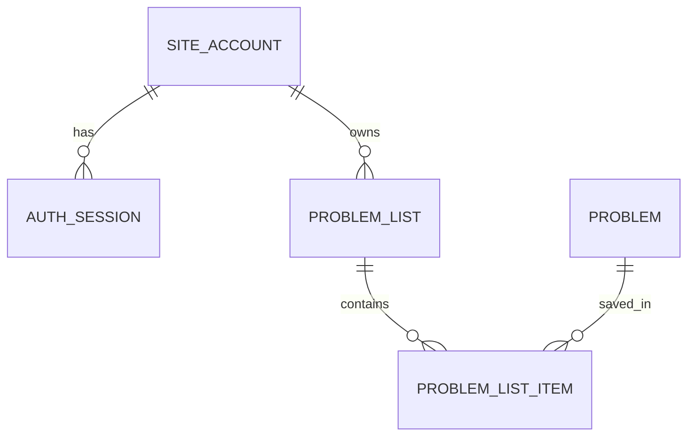

# Accounts, profiles and private practice lists

## Purpose and scope

Coderise now offers optional username/password accounts. A profile page saves a display name and preferred public Codeforces handle. Private problem lists let the account collect practice across devices. Public catalogue, dashboard, recommendation and learning-map views remain accessible without signing in.

The Coderise account and imported Codeforces profile are different identities. Selecting Chatresh, tourist, or any other public handle does not prove ownership. List ownership belongs to the signed-in Coderise account. Solved status is computed from its preferred handle's imported accepted submissions, currently limited to the imported history. Users solve and submit on Codeforces.

## Setup on an existing or freshly restored database

After the earlier schema migrations, install the updated locked dependencies and apply migration 008:

```text
npm ci
npm run db:accounts
```

Set `CODERISE_ORIGIN` in the ignored `.env` to the exact browser origin. For the local demo:

```text
CODERISE_ORIGIN=http://127.0.0.1:3000
```

Use that same hostname/port in the browser. HTTPS is required outside localhost/loopback. An HTTPS origin enables a Secure, host-only `__Host-coderise_session` cookie. Plain HTTP cookies are supported only for explicitly local development. Restart the application after changing configuration.

Open `/register` to create a regular account and optionally save your Codeforces handle during signup. You can also add or change the handle later in `/profile`. Saving a preference does not automatically import unknown handles; use the existing public import flow. A local handle cookie can temporarily select another public profile; the saved preference is available on a fresh browser/device after signing in.

## Roles and administrator setup

| Operation | Visitor | Regular account | Administrator |
|---|---|---|---|
| View public Codeforces data | Yes | Yes | Yes |
| Save profile preferences | No | Own account | Own account |
| Read/edit lists | No | Own lists | Own lists |
| Use catalogue administration | No | No | Yes |
| Read someone else's private lists | No | No | No |

Public signup assigns `user`; sending `role: admin` does not change that. Administrators are provisioned locally by a trusted operator with database access:

```text
npm run account:manage -- create-admin YOUR_USERNAME
```

The command asks for a hidden password and confirmation. It refuses to overwrite an existing username. There is no seeded/default administrator password. Sign in through `/login`, then open `/admin/sync`. Role checks read PostgreSQL on each protected request, so demotion applies to existing sessions.

The old shared `CODERISE_ADMIN_TOKEN` no longer grants access. Its old endpoint returns HTTP 410; the cookie is ignored. It can be removed from local environment files.

## Sign-up, password verification and sessions

1. The server checks the request origin, JSON type, and a 16 KiB streaming body limit.
2. It normalizes the username to lowercase and validates 3–30 letters, digits or underscores.
3. Passwords must be 8–128 characters. Passwords are not trimmed; password-manager paste is allowed.
4. The Argon2 library creates a unique salt and an Argon2id encoded hash using 19 MiB memory, two iterations and one lane. Only the encoded hash is stored.
5. After a successful registration/login, the server creates 32 random bytes as an opaque token. PostgreSQL stores only its SHA-256 digest and a seven-day absolute expiry.
6. The browser gets the raw token in an HTTP-only, SameSite=Lax cookie. It is never returned in JSON or stored in localStorage.
7. Protected requests hash the cookie and join the unexpired session to the current account. Password hashes are never included in account DTOs.

SHA-256 is suitable here for a high-entropy random session token. Passwords use the deliberately slow Argon2id algorithm because human passwords can be guessed.

Login verifies the password while holding an account-row lock. Password changes use the same lock, update the hash, revoke all old sessions and create one replacement session transactionally. This prevents a concurrent login with an old password from surviving a completed password change. Logout revokes the current token and clears the browser cookie.

## PostgreSQL model

Migration `db/migrations/008_accounts_lists.sql` adds:

| Table | Fields and integrity |
|---|---|
| site_account | Identity PK, lowercase unique username, display name, Argon2id password hash, constrained role, optional validated preferred handle, created/updated timestamps |
| auth_session | Unique 64-character token digest PK, account FK with cascade delete, creation/expiry timestamps and expiry check; account/expiry indexes |
| auth_throttle | Hashed limiter key PK, positive attempt count, expiry; expiry index |
| problem_list | Identity PK, owner FK with cascade delete, trimmed 1–80-character name, description up to 500 characters, timestamps; owner/update index |
| problem_list_item | Composite PK of list/problem, cascading list FK, restricted catalogue-problem FK, added timestamp |



`preferred_cf_handle` is optional text rather than an ownership FK; the profile might not have been imported yet. Original public Codeforces records stay in `app_user`, `submission`, and related tables.

## List lifecycle and privacy

A user can create up to 100 private lists, rename/update their descriptions, delete a list, and add/remove up to 1,000 catalogue problems per list. Account/list locks serialize quota checks and writes. A composite primary key makes repeated saves idempotent rather than duplicating entries.

Every list read/write includes the authenticated owner in its SQL condition. Routes never trust an `account_id` supplied by the browser. Access to an absent or another account's list returns the same 404 response. An administrator does not get access to other users' private lists.

The detail view supports text/ID search, solved/unsolved filtering, and 50-row pagination. Solved is an EXISTS query over accepted submissions of the saved preferred public handle. No handle means no positive solved evidence; the UI labels that state. Private API responses carry `Cache-Control: private, no-store` and `Vary: Cookie`.

Save actions are available in the catalogue, recommendation/problem actions, and problem details. The chooser can create a list and save immediately. Opening the chooser loads only the current account's lists.

## Validation, abuse controls and CSRF

- State-changing account/list requests require JSON and an accepted Origin. Configured `CODERISE_ORIGIN` must match exactly.
- SQL values are parameterized; user roles and owner IDs are assigned on the server.
- Database-backed atomic counters limit authentication to 120 attempts per 15 minutes globally and eight attempts per username. Registration is also limited to 20 per hour globally. These counts include successful logins.
- Credential changes are limited to eight attempts per account per 15 minutes; list writes to 120 per account per minute.
- Incorrect login credentials share a generic error. Nonexistent usernames still run password verification against a dummy hash. Signup explicitly reports unavailable usernames; usernames should therefore be treated as discoverable, not secret identifiers.
- Validation bounds names/descriptions/IDs, and output is rendered by React without raw HTML.
- Session tokens, password hashes, passwords and request bodies are not logged. Account errors log only a generic message and error code.
- Security headers deny framing and MIME sniffing; production deployment must also provide HTTPS and suitable infrastructure protections.

The global counters are a conservative guard for the current local server, not a complete distributed anti-abuse service. A deployment needs trusted-proxy/client addressing and infrastructure limits. There is no MFA or email recovery. Database credentials still live in ignored local environment configuration; password hashing does not encrypt that configuration.

## Recovery and deletion

No email is collected, so forgotten passwords require a trusted local operator:

```text
npm run account:manage -- reset-password YOUR_USERNAME
```

The command preserves the account role, replaces its password hash and revokes all sessions. A signed-in account can change its own password from Profile after verifying the current password.

Account deletion requires the current password and a separate visible confirmation form. It deletes the account, sessions, lists and list entries using FK cascades. It preserves public Codeforces catalogue/history records. List deletion removes only that list and its entries.

## Backup privacy

The shareable transfer-backup script excludes rows from `site_account`, `auth_session`, `auth_throttle`, `problem_list` and `problem_list_item`, in addition to transient sync jobs. Schema definitions remain so a restore can recreate empty tables. Restore verification expects those tables to have zero rows.

Never publish a raw full database dump containing real account hashes or private lists. A private operational backup preserving accounts needs separate secure storage and a separately reviewed workflow. Do not weaken the shareable-backup exclusions for convenience.

## Files and verification

- `lib/account-security.ts`: password/token primitives and cookie/origin configuration.
- `lib/account-store.ts`: transactional credential/session lifecycle and throttling.
- `lib/auth.ts`: request identity, bounded JSON parsing, cookie responses and safe errors.
- `lib/lists.ts`: owner-scoped list queries and writes.
- `app/api/auth`, `app/api/account`, `app/api/lists`: HTTP boundaries.
- `app/profile`, `app/lists`, `components/*account*`: user interface.
- `tests/account-security.test.ts`: hashing and validation checks.
- `scripts/check-accounts.mjs`: disposable-account API regression checks.

```text
npm test
npm run typecheck
npm run build
node scripts/check-accounts.mjs
```

Run the API check against the running local app after migration 008. It creates synthetic accounts, checks isolation/session behavior and removes those accounts in finally. It changes a synthetic account's role briefly to verify authorization; it never creates a persistent administrator. Repeated runs are subject to real rate limits.

## Presentation explanation

“Coderise accounts and Codeforces profiles represent different identities. Public data stays browsable, but personal lists belong to the signed-in Coderise account. PostgreSQL enforces the list relationships and stores salted password hashes and revocable session digests. Every private query includes the authenticated owner. Administrators can maintain the catalogue, but cannot access other users' private lists.”

Demonstrate signup, saved profile, creating a list, saving the same problem twice, and opening that list after signing in elsewhere. Explain how cross-account API checks return 404. Then show the admin role restriction, a password change revoking old sessions, and the schema relationships. Do not display password hashes, live cookies, or environment credentials during presentation.

References: [OWASP password storage](https://cheatsheetseries.owasp.org/cheatsheets/Password_Storage_Cheat_Sheet.html), [OWASP session management](https://cheatsheetseries.owasp.org/cheatsheets/Session_Management_Cheat_Sheet.html), [Next.js authentication](https://nextjs.org/docs/app/guides/authentication), [node-argon2](https://github.com/ranisalt/node-argon2).
