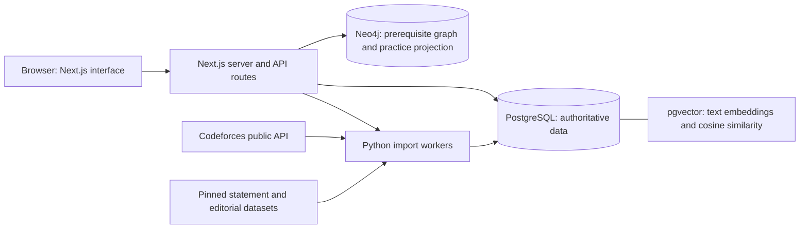

# Coderise: how the project works

For detailed guides by subsystem, start with [the implementation guide index](explained/README.md). This file is the shorter overview.

This guide explains the implemented project for a course presentation. Coderise currently works through public Codeforces handles without learner login.

## 1. What problem are we solving?

Codeforces offers many problems, but choosing suitable practice and deciding what background to review can be difficult. Coderise combines public practice history, problem metadata, text similarity, and a topic prerequisite graph to provide practice suggestions and preparation for a specific problem. It is a practice companion; users solve and submit on Codeforces.

## 2. The overall architecture

The browser displays data and collects input. Server-side code validates requests and asks the databases for results. Database credentials stay on the server. PostgreSQL stores the original application data; Neo4j contains a curated graph and a derived projection of public practice evidence. pgvector is an extension inside PostgreSQL, not a separate running database service.

## 3. Frontend: what the user sees

Next.js and React provide the handle entry page, dashboard, recommendations, searchable problem catalogue, problem detail page, and problem preparation screen. Components render tables, charts, filters, checkboxes, pagination, statement mathematics, and graph interactions.

Pages and components do not decide database permissions or run SQL in the browser. Server-rendered pages obtain data through server helpers; browser interactions use Next.js API routes where needed. For example, changing catalogue filters changes query parameters, which the server validates and translates into parameterized database queries.

The selected handle cookie is a browser preference, not a login. Anyone may inspect another public Codeforces profile.

## 4. Backend: the coordinator

Next.js route handlers and server-only helpers sit between the UI and databases. They validate handles, ratings, modes, page numbers, and problem IDs. SQL values are passed as parameters; sortable fields and modes use allowlists. The server returns the fields needed by the interface rather than exposing database credentials or complete vector arrays.

Main API examples:

- `/api/profiles/[handle]`: imported profile and dashboard information.
- `/api/problems/search`: search, filters, sorting, and pagination.
- `/api/recommendations`: recommendations for a profile and mode.
- `/api/path`: preparation for a problem or topic exploration.
- `/api/sync`: starts or reuses a public-profile import job.

The protected developer console controls catalogue operations using the existing developer token. It is separate from public browsing.

## 5. PostgreSQL: the source of truth

The main relational tables represent public Codeforces profiles (`app_user`), contests, problems, tags, problem/tag links, submissions, and rating changes. A problem can have many tags and a tag can belong to many problems, so `problem_tag` is the junction table. Submissions connect a profile to a problem and record verdict, time, language, and resource usage.

Additional tables store statements, editorials, retrieval embeddings, import jobs, and derived topic statistics. Statements and editorials carry source identifiers and hashes so their origin and changes can be tracked.

The name `app_user` is historical: it represents an imported Codeforces profile, not a local login account. `recommendation`, `tag_prerequisite`, and `problem_embedding` include reserved or legacy structures; their presence does not mean every original planned feature is active. Current semantic retrieval uses `retrieval_embedding`; current prerequisite traversal uses Neo4j.

Primary keys identify rows. Foreign keys prevent references to missing parents. Unique constraints prevent duplicates such as repeated contest/problem-index pairs. CHECK constraints reject invalid ratings, counts, verdicts, or vectors. Indexes help common lookup and filtering patterns. Views package reusable queries, and SQL functions implement recommendation candidate selection and vector retrieval.

## 6. Importing a handle

1. The visitor enters a handle, and the server validates it.
2. Existing imported data can be displayed immediately. A new or refreshed profile starts a tracked import job.
3. A Python worker calls the Codeforces public API for profile information, recent submissions, and rating history.
4. The worker inserts new records or updates existing ones using stable IDs and upserts. This avoids duplicating data on refresh.
5. The job table records progress, completion, or failure. The interface polls job status.
6. PostgreSQL serves the refreshed dashboard and practice data.

Imports currently cover up to 2,000 recent submissions per handle. Therefore solved counts, exclusions, and topic statistics describe imported history, not necessarily the user's entire career. Active-page refresh is polling while the website is open; it is not an unattended scheduler.

## 7. Dashboard calculations

The dashboard reads profile metadata, rating changes, and submissions from PostgreSQL. Queries join related tables and aggregate results into unique accepted problems, acceptance statistics, weekly activity, streaks, recent submissions, and topic history.

Topic statistics are maintained through database logic and refresh reconciliation. The submission trigger handles new judged submissions and pending-to-final verdict updates. It should not be described as repairing every possible arbitrary manual edit or deletion. Topic acceptance is an observed statistic, not proof of mastery.

Hover effects and chart selection happen in the frontend; the underlying values come from imported database records.

## 8. How recommendations work

The three modes are Warm up, Stretch, and Fix weaknesses. SQL first builds a bounded shortlist using rating, imported solved status, topic history, and catalogue popularity. Accepted problems in imported history are excluded. When there is too little history, the system uses conservative starter behavior rather than claiming a reliable weakness diagnosis.

If compatible text embeddings and history references exist, pgvector supplies semantic evidence to adjust the shortlist ranking. Otherwise the baseline score is retained. The vector adjustment cannot introduce a problem outside the eligible shortlist.

### What is embedded?

The active encoder is the pinned `sentence-transformers/all-MiniLM-L6-v2` model, run offline on CPU through ONNX. Statement input uses description and input/output formats. Editorial input uses the supplied explanation. Titles, tags, and ratings are not added to this embedding text.

Long sources are encoded in overlapping windows, pooled, and normalized into one 384-dimensional vector per source. These vectors are stored in `retrieval_embedding` alongside source kind, model revision, encoding recipe, source/input hashes, chunk count, and creation time.

### What does pgvector do?

PostgreSQL computes cosine distance with `<=>`; similarity is `1 - distance`. The retrieval functions select fresh references with matching model/revision/recipe and compare candidates against compatible history. Editorial evidence receives a stronger bounded adjustment than statement evidence. Missing evidence leaves the baseline unchanged.

HNSW indexes are available for catalogue similarity searches. Recommendation scoring deliberately computes exact comparisons within a bounded shortlist; an index existing does not imply every query uses approximate search.

These scores are ranking signals, not solve probabilities. Evaluation confirmed functional retrieval and eligibility behavior, but technique relevance is uneven and superiority over the baseline is not established. MiniLM is not an LLM tutor, and no live Ollama generation is needed for recommendations.

## 9. How preparation for a specific problem works

1. The user supplies a Codeforces problem ID or canonical URL. The URL is parsed as an identifier; the server does not fetch arbitrary URLs.
2. PostgreSQL returns the target problem, rating, and tags.
3. Supported tags become simultaneous goals in the curated Neo4j prerequisite graph.
4. Neo4j returns their combined prerequisite branches, rather than only one shortest route.
5. PostgreSQL supplies rated practice problems for each topic, excluding the target, accepted problems in imported history, and duplicates across the plan.
6. The frontend displays the map, topic explanations, and practice cards, then links back to the original target.

The graph currently contains 19 curated topics and 21 prerequisite edges. These are explicit human-designed background relationships, not prerequisites inferred by an LLM. Unmapped tags are labelled and may receive direct tag-based practice without invented graph edges.

Practice difficulty considers both learner and target rating. An 800-rated target has no lower rated catalogue band, so the UI explicitly shows same-rating practice. Unrated targets use learner-based difficulty without claiming that suggestions are easier.

This feature uses graph, topic, and rating rules. The separate Recommendations screen uses the pgvector hybrid. Preparation does not analyze a target solution or guarantee that it identifies the crucial observation.

## 10. Why Neo4j is useful

Neo4j stores topics connected by `PREREQUISITE_OF` relationships, including explanations for the edges. It also holds a derived public-practice projection: Profile -> SOLVED -> Problem -> HAS_TAG -> Topic. This allows traversal from a goal through its background and into existing accepted examples.

PostgreSQL remains authoritative for imported records. The graph projection is refreshed from PostgreSQL snapshots when map requests need it. Snapshot hashes and transactions avoid unnecessary or inconsistent rewrites. Losing the projection does not mean losing the original Codeforces history; it can be rebuilt.

## 11. Why use these three database paradigms?

| Paradigm | Reason in Coderise | Visible result |
|---|---|---|
| Relational PostgreSQL | Structured related data, integrity, joins, aggregates, transactional imports | Catalogue, dashboard, history, candidate selection |
| Vector storage with pgvector | Compare unstructured statement/editorial text numerically | Semantic adjustment of practice recommendations |
| Graph database with Neo4j | Traverse connected prerequisite branches and practice evidence | Preparation map and background topics |

Redis is not implemented. It is not necessary to explain the current architecture as complete. Adding another database solely to increase the technology count would not improve the presentation.

## 12. A suggested presentation walkthrough

1. Explain the practice-selection problem and the three database responsibilities.
2. Enter a public handle and show imported-history limitations on the dashboard.
3. Show the relational schema in pgAdmin: problem, tag, junction table, submission, and their keys.
4. Demonstrate joins/aggregation, a view, a function, a trigger, and constraints using safe examples.
5. Open Recommendations with a profile that has compatible vectors. Show native `vector(384)`, cosine retrieval, and hybrid versus fallback behavior.
6. Paste a target problem into preparation. Show how its tags lead to Neo4j background branches and PostgreSQL practice suggestions.
7. Explain evaluation results, limitations, and each teammate's actual contribution.

Existing database demonstration files are `db/demo/vector_queries.sql` and `db/demo/learning_graph.cypher`. A core relational query sheet including HAVING still needs to be assembled for the final demo.

## 13. Questions to be ready for

**Why not keep everything in SQL?** SQL could represent many graph relationships, but Neo4j makes multi-hop background traversal explicit. pgvector extends PostgreSQL for similarity while retaining relational metadata and constraints.

**Are recommendations AI-generated?** They combine SQL ranking rules with similarities from precomputed embeddings. They are not generated by a conversational model.

**Does a graph edge prove a topic is necessary for this exact problem?** No. It represents general suggested background; tags can reflect alternative solutions and the crucial observation may be missed.

**Is the database updated automatically all the time?** Profile imports can refresh while a page is active. Catalogue/text/model updates are explicit workflows; there is no general unattended scheduler.

**Does Coderise know every solved problem?** Only the history imported into the local database. The UI and evaluation must state that limit.

**What is stored in the browser?** UI state and a preferred-handle cookie. Database records and embeddings live on the server. The cookie is not authentication.

**What remains for submission?** Publish the design documentation, complete the core SQL demo/query sheet, reconcile setup instructions on a fresh machine, assemble the report/screenshots/test evidence, and document real contributions from both teammates.
