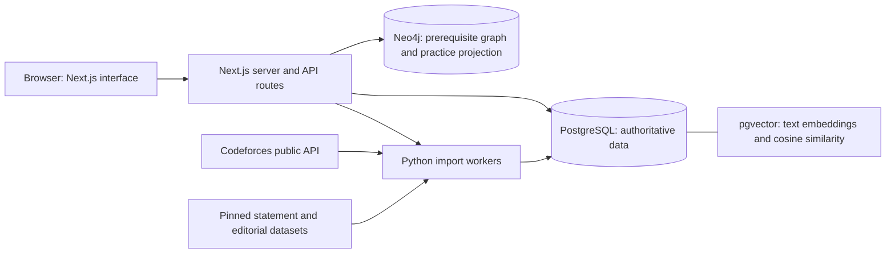

# Architecture and data flow

## 1. What problem are we solving?

Codeforces offers many problems, but choosing suitable practice and deciding what background to review can be difficult. Coderise combines public practice history, problem metadata, text similarity, and a topic prerequisite graph to provide practice suggestions and preparation for a specific problem. It is a practice companion; users solve and submit on Codeforces.

## 2. The overall architecture

The browser displays data and collects input. Server-side code validates requests and asks the databases for results. Database credentials stay on the server. PostgreSQL stores the original application data; Neo4j contains a curated graph and a derived projection of public practice evidence. pgvector is an extension inside PostgreSQL, not a separate running database service.

## Source-code map and responsibility boundaries

app/ contains pages and API routes. components/ contains reusable UI. lib/ contains server data access and pure ranking/validation rules. scripts/ contains importers, migration runners, offline encoding, backup, and check utilities. db/ contains schema, migrations, and demo queries. config/ pins the retrieval model/recipe and curated learning graph.

A normal recommendation request follows page/route -> lib/data.ts -> PostgreSQL candidate and similarity functions -> lib/recommendation-ranking.ts -> UI. Encoding happens beforehand. The response is a ranking result, not generated prose from a live language model.

PostgreSQL is authoritative for imported facts. Neo4j's accepted-practice connections are a projection and can be rebuilt from SQL. The curated prerequisite edges come from config/learning-topics.json. Embeddings are derived from text and are tied to model and source hashes.

There is no global transaction spanning Codeforces, PostgreSQL, and Neo4j. Each database protects its own writes; stable identifiers, hashes, versions, and retryable workflows coordinate the systems. Be clear about this distinction when asked about consistency.

## Why the technologies belong here

Relational tables suit profiles, problems, submissions, and their constraints. Vector representations suit numerical comparison of unstructured source text. A graph suits ancestor traversal and multiple prerequisite branches. Redis is not implemented, and no live model server is required for serving cached recommendations.